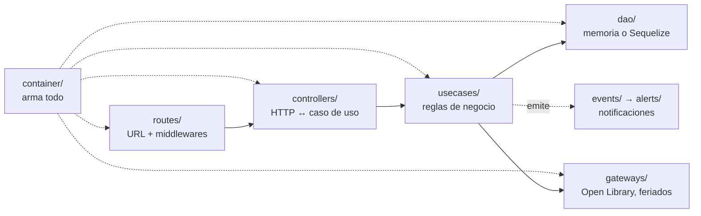

# Biblioteca API

API REST para administrar una biblioteca: inventario de libros, socios y préstamos con reglas de negocio (tope de préstamos, vencimiento en días hábiles, renovaciones). Incluye autenticación con JWT, importación de libros por ISBN desde Open Library y exportación a CSV.

Proyecto integrador de **Taller de Programación 2**. Está pensado para leerse: cada decisión de diseño está explicada en un comentario cerca del código que la implementa.

- **Documentación interactiva:** `http://localhost:8000/docs` (Swagger UI)
- **Contrato OpenAPI 3.1:** `http://localhost:8000/openapi.json`

---

## Requisitos

- **Node.js 22 o superior** (`node -v`). Se usa `--env-file` de Node, no hace falta `dotenv`.
- npm (viene con Node).
- Nada más: por defecto los datos viven en memoria. SQLite es opcional y no requiere instalar un servidor.

## Puesta en marcha

```bash
git clone <url-del-repo>
cd biblioteca-api
npm install
cp .env.example .env      # en Windows (PowerShell): Copy-Item .env.example .env
npm run dev               # o npm start, sin recarga automática
```

Deberías ver:

```
Servidor Express (Clase 15) corriendo en http://localhost:8000
Documentación: http://localhost:8000/docs
```

**Primer pedido:** abrí `http://localhost:8000/docs`, ejecutá `POST /auth/login` con el administrador inicial (`admin@biblioteca.com` / `Admin1234`, ver `.env`), copiá el `token`, tocá **Authorize** y pegalo. Desde ahí podés probar cualquier endpoint.

> Si no tenés internet, poné `CATALOG_TYPE=fake` y `HOLIDAYS_TYPE=fake` en el `.env`: todo funciona con datos locales.

## Variables de entorno

Todas tienen un valor por defecto salvo `JWT_SECRET`, que es obligatoria a propósito: sin ella la aplicación no arranca.

| Variable | Por defecto | Para qué sirve |
|---|---|---|
| `PORT` | `8000` | Puerto HTTP |
| `NODE_ENV` | `development` | `production` apaga la documentación si no se define `DOCS_ENABLED` |
| `PERSISTENCE_TYPE` | `memory` | `memory` (se pierde al reiniciar) o `sequelize` (SQLite en `database.sqlite`) |
| `NOTIFIER_TYPE` | `console` | Dónde se avisan las alertas de stock bajo: `console` o `file` |
| `NOTIFICATIONS_LOG_PATH` | `notifications.log` | Archivo de las notificaciones con `NOTIFIER_TYPE=file` |
| `LOW_STOCK_THRESHOLD` | `2` | Con este stock o menos, se emite una alerta |
| `JWT_SECRET` | — (**obligatoria**) | Firma los tokens. Generala con `node -e "console.log(require('node:crypto').randomBytes(48).toString('hex'))"` |
| `JWT_EXPIRES_IN` | `1h` | Vida del token (`15m`, `1h`, `7d`) |
| `BCRYPT_ROUNDS` | `10` | Costo del hash de contraseñas (cada +1 duplica el tiempo) |
| `LOGIN_RATE_LIMIT_MAX` | `5` | Intentos de login **fallidos** por IP y por minuto |
| `ADMIN_EMAIL` / `ADMIN_PASSWORD` | `admin@biblioteca.com` / — | Administrador que se crea al arrancar. Sin contraseña no se crea |
| `CATALOG_TYPE` | `openlibrary` | `openlibrary` (API real) o `fake` (sin red) |
| `OPEN_LIBRARY_URL` | `https://openlibrary.org` | URL del catálogo externo |
| `EXTERNAL_TIMEOUT_MS` | `5000` | Tiempo máximo de espera de cada pedido a una API externa |
| `IMPORT_CONCURRENCY` | `3` | Pedidos simultáneos al importar libros |
| `CATALOG_CACHE_TTL_MS` | `0` | Caché del catálogo (0 = apagada) |
| `EXTERNAL_RETRIES` / `EXTERNAL_RETRY_BASE_MS` | `0` / `1000` | Reintentos ante fallas transitorias, con espera exponencial |
| `FAKE_LATENCY_MS` | `300` | Demora simulada del catálogo falso |
| `LOAN_MAX_ACTIVE` | `3` | Préstamos activos por usuario (regla R1) |
| `LOAN_BUSINESS_DAYS` | `10` | Plazo del préstamo en días hábiles (R2) |
| `LOAN_MAX_RENEWALS` | `1` | Renovaciones por préstamo (R4) |
| `HOLIDAYS_TYPE` | `argentinadatos` | Feriados: `argentinadatos` (API real), `fake` o `fake-down` (simula la API caída) |
| `HOLIDAYS_URL` | `https://api.argentinadatos.com` | URL de la API de feriados |
| `CLOCK_NOW` | vacío | Fija el reloj para "viajar en el tiempo" al probar (ej. `2027-01-15T12:00:00Z`) |
| `DOCS_ENABLED` | `true` (`false` en producción) | Publica `/docs` y `/openapi.json` |

## Scripts

| Comando | Qué hace |
|---|---|
| `npm run dev` | Levanta el servidor y lo reinicia al guardar un archivo |
| `npm start` | Levanta el servidor |
| `npm test` | Corre todos los tests (no necesita `.env` ni servidor) |
| `npm run test:watch` | Tests en modo watch |
| `npm run coverage` | Tests con reporte de cobertura en `coverage/index.html` |
| `npm run docs:export` | Escribe el contrato en `openapi.json` (para importarlo en Postman o Insomnia) |

## Endpoints

El detalle completo (parámetros, cuerpos, respuestas y cada código de error posible) está en **`/docs`**. Resumen:

| Recurso | Endpoints | Acceso |
|---|---|---|
| Autenticación | `POST /auth/register`, `POST /auth/login`, `GET /auth/me`, `PUT /auth/password` | Registro y login públicos |
| Libros | `GET /books`, `GET /books/:id`, `GET /books/:id/details`, `POST /books`, `PUT /books/:id`, `DELETE /books/:id`, `POST /books/import`, `GET /books/export.csv` | Lectura pública; escritura solo admin |
| Préstamos | `GET /loans`, `GET /loans/:id`, `POST /loans`, `PUT /loans/:id/return`, `PUT /loans/:id/renew` | Con token; un lector solo ve y opera los suyos |
| Usuarios | `GET /users`, `GET /users/:id`, `POST /users`, `PUT /users/:id`, `DELETE /users/:id` | Solo admin |
| Catálogo externo | `GET /catalog/lookup` | Con token |

**Errores:** todos con el mismo formato. Compará el `code`, no el `message`:

```json
{ "error": { "code": "LOAN_LIMIT_REACHED", "message": "Un usuario puede tener hasta 3 préstamos activos" } }
```

### Reglas de negocio de los préstamos

| # | Regla | Si se rompe |
|---|---|---|
| R1 | Como máximo 3 préstamos activos por usuario | `409 LOAN_LIMIT_REACHED` |
| R2 | Vence a los 10 días hábiles (sin fines de semana ni feriados) | — (se calcula; si la API de feriados cae, se presta igual) |
| R3 | Con algún préstamo vencido no se pide otro | `409 USER_HAS_OVERDUE_LOANS` |
| R4 | Se renueva una sola vez, si no está vencido ni devuelto | `409 RENEWAL_LIMIT_REACHED` / `LOAN_OVERDUE` / `ALREADY_RETURNED` |
| R5 | El ISBN debe tener un dígito de control válido | `400 VALIDATION_ERROR` |

## Arquitectura

Arquitectura en capas con inyección de dependencias manual. Cada capa conoce solo a la de abajo, y lo que cambia según el entorno (base de datos, APIs externas, reloj) se elige en un único lugar: el **Composition Root** (`container/container.js`).



```
config/          variables de entorno (único lugar que lee process.env)
container/       Composition Root: crea e inyecta todas las dependencias
routes/          URL + validación (Zod) + autenticación; delega en el controller
controllers/     traduce HTTP ↔ caso de uso (status codes, headers)
usecases/        reglas de negocio; no conocen Express, ni la base, ni fetch
domain/          funciones puras del negocio (días hábiles, estado de un préstamo)
dao/             persistencia intercambiable: memoria o Sequelize (SQLite)
gateways/        APIs externas (Open Library, ArgentinaDatos) y sus versiones falsas
events/ alerts/ notifications/   alertas desacopladas por eventos
security/        hash de contraseñas (bcrypt) y tokens (JWT)
schemas/         validación de entrada con Zod
docs/            contrato OpenAPI, generado a partir de los esquemas de Zod
tests/           tests unitarios, de contrato y de documentación (Vitest)
```

**Decisiones que conviene conocer:**

- **Los casos de uso no leen `process.env`, no llaman a `new Date()` ni a `fetch`.** Todo les llega inyectado. Por eso se pueden testear sin infraestructura y se puede "viajar en el tiempo" con `CLOCK_NOW`.
- **El estado "vencido" se calcula, no se guarda.** La base guarda hechos (fechas); la conclusión depende del día de hoy.
- **Las APIs externas son un extra.** Si Open Library o la API de feriados no responden, la biblioteca sigue funcionando (degradación elegante) y lo informa en la respuesta.
- **La documentación sale del código.** Los cuerpos y parámetros se generan desde los mismos esquemas de Zod que validan los pedidos, y un test falla si una ruta de Express no está documentada.

## Tests

```bash
npm test
```

No necesitan `.env`, ni base de datos, ni red: todas las dependencias se reemplazan por dobles.

| Carpeta | Qué verifica |
|---|---|
| `tests/domain`, `tests/utils` | Funciones puras (días hábiles, ISBN, CSV, reloj...) |
| `tests/usecases` | Cada regla de negocio, con su caso feliz, sus bordes y sus errores |
| `tests/contract` | Que lo que devuelven los casos de uso coincide con lo documentado |
| `tests/docs` | Que el contrato OpenAPI es válido y coincide con las rutas y permisos reales de Express |

## Probar a mano

- **Swagger UI** en `/docs` ("Try it out").
- **`requests.http`** con la extensión REST Client de VS Code: pedidos numerados por clase, con los tokens encadenados. La URL del servidor está en la variable `@baseUrl`.
- **Postman / Insomnia:** `npm run docs:export` y después *Import → File → `openapi.json`*. Arma la colección completa.

## Limitaciones conocidas

- **Un token sigue valiendo hasta que vence**, aunque el usuario se haya eliminado o haya cambiado de rol (JWT sin estado). Se mitiga con una vida corta (`JWT_EXPIRES_IN`).
- **El tope de préstamos (R1) tiene una condición de carrera:** dos pedidos simultáneos del mismo usuario podrían superar el tope por uno. El préstamo duplicado del mismo libro sí lo frena un índice único.
- **`sync()` sin migraciones:** si cambia un modelo de Sequelize, hay que borrar `database.sqlite`.
- **El catálogo de códigos de error de la documentación** (`docs/errorCatalog.js`) se mantiene a mano.
- **El rate limit del login vive en memoria:** con más de una instancia del servidor, cada una cuenta por separado.

## Problemas frecuentes

| Síntoma | Causa y solución |
|---|---|
| `Falta la variable de entorno JWT_SECRET` | No copiaste el `.env`: `cp .env.example .env` |
| `EADDRINUSE: address already in use :::8000` | Otro proceso usa el puerto: cerralo o cambiá `PORT` |
| `401 TOKEN_EXPIRED` | Venció el token: volvé a hacer login |
| `/docs` responde 404 | `DOCS_ENABLED=false` o `NODE_ENV=production` |
| Error de columnas al usar `sequelize` | El modelo cambió: borrá `database.sqlite` |
| `502` / `504` en `/books/:id/details` o al importar | Open Library no responde. Usá `CATALOG_TYPE=fake` |

## Licencia

ISC. Proyecto con fines educativos.
