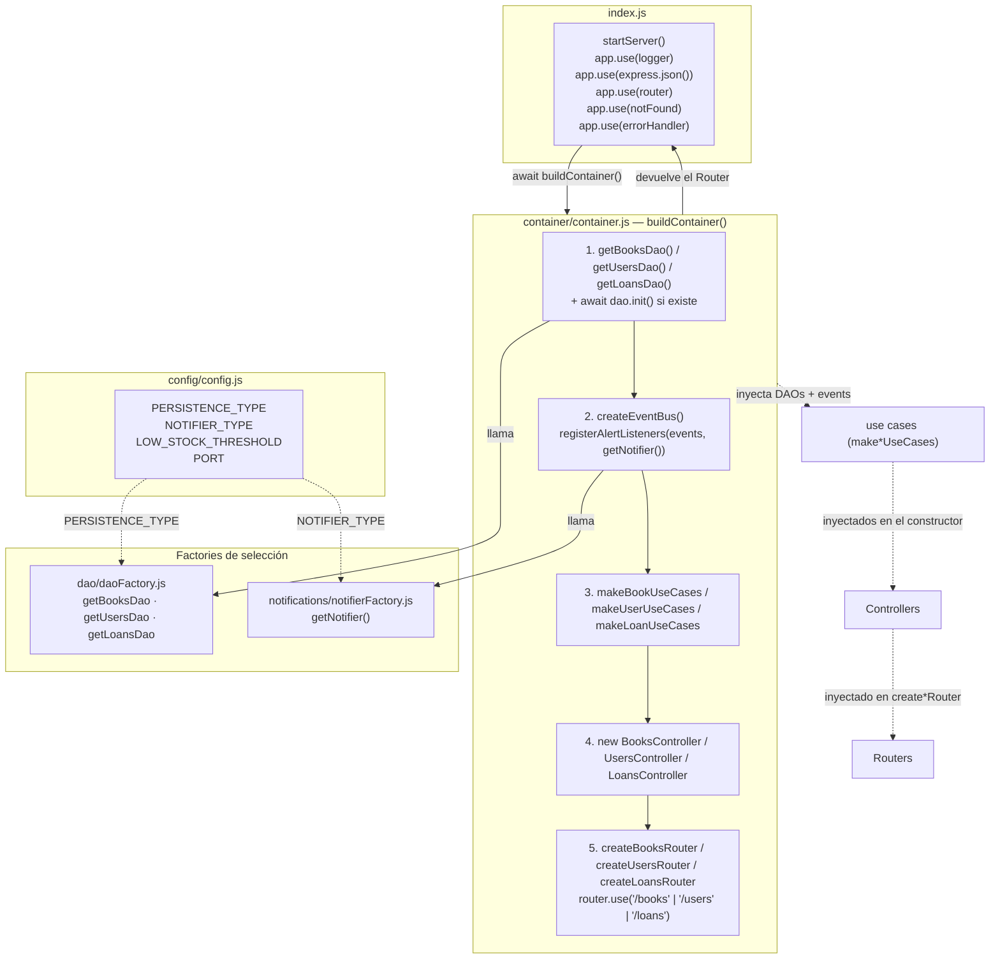
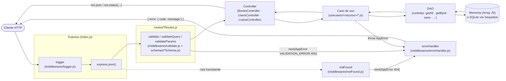
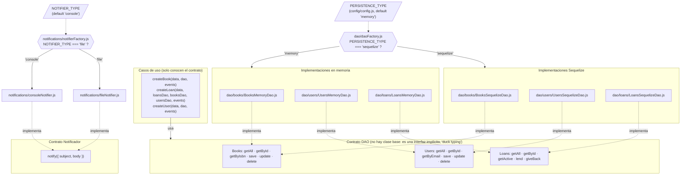
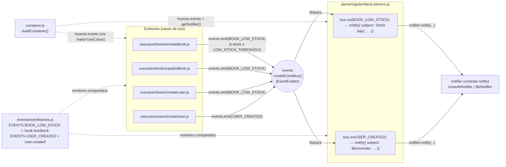
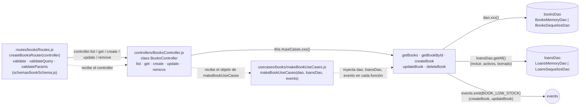
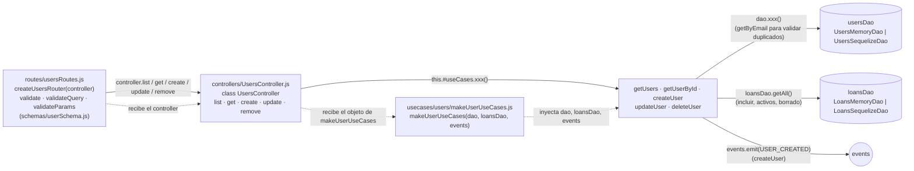
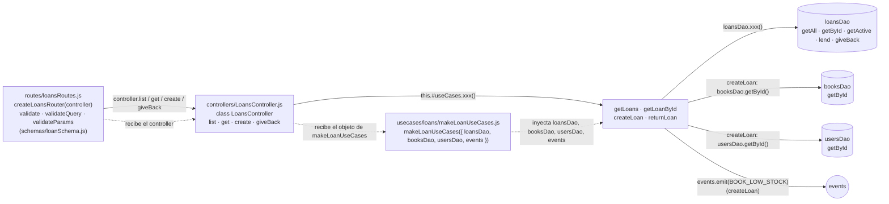
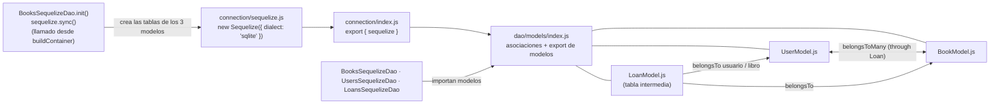

# Arquitectura de la API de Biblioteca (Clase 10)

Este documento muestra cómo está armado el cableado del proyecto y cómo funciona la inyección de dependencias, leyendo el código real.

**Recursos que existen hoy:** libros (`/books`), usuarios (`/users`) y préstamos (`/loans`).
**Lo que no existe (todavía):** auth, hasheador de contraseñas y tokens. No hay nada de eso en el código, por eso no aparece en los diagramas.

**Convención de flechas en todos los diagramas:**

- Flecha continua `-->` = **llama** (flujo de ejecución en runtime).
- Flecha punteada `-.->` = **inyecta** (el container le pasa una dependencia a otra pieza al armarla).

> Nota sobre carpetas: en el disco la carpeta es `usecases/` y el `container.js` importa desde `../usecases/...`. En el índice de git figura como `useCases/` (y `booksController.js` en minúscula). En macOS anda igual, pero en Linux (por ejemplo en un deploy) los imports podrían fallar por mayúsculas/minúsculas. En los diagramas uso los nombres tal como los importa el código.

---

## 1. Diagrama general: quién crea qué (Composition Root)

**Cómo se lee:** `index.js` solo arma Express y le pide el router a `buildContainer()`; no conoce ninguna clase concreta. Dentro de `container/container.js` se ve el orden de armado de abajo hacia arriba: primero DAOs (elegidos por `daoFactory.js` según `PERSISTENCE_TYPE`), después el bus y el notificador, luego los casos de uso, los controllers y los routers. Las flechas punteadas son inyecciones: cada capa recibe ya armada a la de abajo.

---

## 2. Flujo de una petición (de punta a punta)

**Cómo se lee:** de izquierda a derecha va la petición: pasa por `logger` y `express.json()` (globales en `index.js`), después por el middleware de validación de cada ruta (Zod), y recién ahí llega al método del controller. El controller delega en el caso de uso, que usa el DAO. Los errores (`AppError`) cortan el flujo y van a `errorHandler`, que arma la respuesta JSON. `notFound` atrapa lo que ningún router resolvió.

---

## 3. Contratos: casos de uso → DAO / notificador, y elección por variable de entorno

**Cómo se lee:** los casos de uso reciben el DAO por parámetro y solo llaman a métodos del contrato, nunca importan `BooksMemoryDao` ni `BooksSequelizeDao`. Quien decide la implementación es `dao/daoFactory.js`, mirando `PERSISTENCE_TYPE` (por defecto `"memory"`). El notificador funciona igual: `notifierFactory.js` elige `consoleNotifier` o `fileNotifier` según `NOTIFIER_TYPE`, y ambos respetan `notify({ subject, body })`. Los contratos no están declarados en código (no hay interfaz ni clase base): son una convención que se mantiene a mano.

> Ojo con un detalle: `LoansMemoryDao` **no** recibe sus DAOs por inyección desde el container. Su constructor tiene como valores por defecto los singletons `booksMemoryDao` y `usersMemoryDao` importados directamente. Funciona porque el container usa esos mismos singletons, pero es un acoplamiento oculto. Además, el contrato de libros tiene un método extra, `adjustStock`, que solo implementa `BooksMemoryDao` y lo usa `LoansMemoryDao` (la versión Sequelize hace el ajuste de stock dentro de su propia transacción en `LoansSequelizeDao.lend` / `giveBack`).

---

## 4. Eventos: emisor, bus y listeners

**Cómo se lee:** hay un único bus (`createEventBus()` devuelve un `EventEmitter` de Node) creado en `buildContainer()` e inyectado tanto a los casos de uso (emisores) como a `registerAlertListeners` (oyente). Los emisores no saben quién escucha, y los listeners no saben quién emite; solo comparten los nombres de `events/eventNames.js`. Los listeners tienen `try/catch`, así que si falla la notificación no se rompe el caso de uso que emitió el evento.

---

## 5. Cadena completa por recurso

### 5.1 Libros (`/books`)

**Cómo se lee:** el router de libros recibe el `BooksController` ya armado; el controller recibe el objeto que devuelve `makeBookUseCases(booksDao, loansDao, events)`. Cada función del objeto es un closure que ya tiene el DAO enganchado, por eso el controller llama `getBooks(req.query)` sin pasar el DAO. `loansDao` se usa para incluir préstamos en las consultas y para impedir borrar un libro con préstamos (`deleteBook`).

### 5.2 Usuarios (`/users`)

**Cómo se lee:** misma forma que libros. `createUser` valida el email con `dao.getByEmail`, guarda con `dao.save` y emite `USER_CREATED`. `updateUser` solo usa `dao` (no recibe `loansDao` ni `events`, aunque `makeUserUseCases` los tiene a mano). `deleteUser` consulta `loansDao` para no borrar usuarios con préstamos.

### 5.3 Préstamos (`/loans`)

**Cómo se lee:** es el recurso con más dependencias. `makeLoanUseCases` recibe un único objeto con los tres DAOs y el bus (a diferencia de libros y usuarios, que usan parámetros posicionales). `createLoan` valida que existan el usuario y el libro, chequea que no tenga ya ese préstamo activo (`getActive`), presta con `loansDao.lend` (descuenta stock) y emite `BOOK_LOW_STOCK` si el stock quedó bajo. `returnLoan` solo usa `loansDao` (`getById` y `giveBack`, que repone el stock).

### 5.4 Auth

No existe en este proyecto: no hay router, controller, caso de uso, hasheador de contraseñas ni servicio de tokens. Cuando se agregue, el lugar natural es el mismo patrón: un `make*UseCases` que reciba el DAO y los servicios (hasheador, tokens) desde `container/container.js`.

---

## 6. Modelos Sequelize (solo si `PERSISTENCE_TYPE=sequelize`)

**Cómo se lee:** la conexión se crea una sola vez en `connection/sequelize.js` y se reexporta desde `connection/index.js`. `dao/models/index.js` define las relaciones (usuarios y libros N a N a través de préstamos) y es lo único que importan los DAOs Sequelize. Las tres tablas se crean con un único `sequelize.sync()` que corre en `BooksSequelizeDao.init()`, por eso `buildContainer()` llama a ese `init()` primero.

---

(si tu editor no renderiza Mermaid, instalá la extensión "Markdown Preview Mermaid Support" en VSCode, o mirá el archivo directamente en GitHub)
