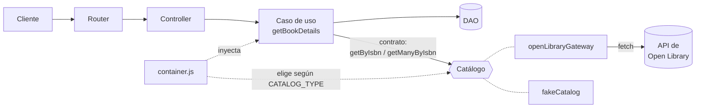

# Clase 12 — Consumo de APIs externas y exportación a CSV

## Objetivos de la clase

- Entender **para qué** un sistema consume una API externa (en nuestra biblioteca: dar de alta libros desde el ISBN, sin tipear) y qué se espera de él cuando esa API falla.
- Consumir una **API pública** desde Node con `fetch` y entender qué cambia cuando una dependencia está **afuera de nuestro control** (red, latencia, formato ajeno, caídas).
- Distinguir los **errores de red** de los **errores HTTP**, y poner un **timeout** a cada pedido.
- Encapsular la API externa en un **gateway** inyectado, igual que el DAO y el notificador, y **traducir** su modelo al nuestro.
- Comparar tres estrategias para varios pedidos: **secuencial**, **paralelo** (`Promise.all` / `Promise.allSettled`) y **en lote**; y limitar la concurrencia.
- Manejar **fallos parciales**: qué hacer cuando solo una parte de los pedidos falla.
- **Transformar datos** (`map`, `filter`, normalizar) y generar un **CSV descargable** de forma segura.

*(Conecta con la clase 2: ahí vimos `async/await`, `Promise.all` y pedidos en serie contra una API pública, y hoy lo aplicamos dentro de la arquitectura en capas. Con la 8 y la 9: el gateway se elige por variable de entorno como el DAO. Con la 10: importar libros reutiliza `createBook` y por lo tanto dispara las alertas de stock. Con la 11: los endpoints que gastan pedidos a un tercero están protegidos. Con la 13: los códigos 502 y 504 de hoy se repasan junto con el resto de los status codes. Con la 14: el catálogo falso sirve para testear sin red.)*

---

## 1. la situación: ¿para qué le pegamos a una API externa?

Antes de ver cómo se hace, conviene tener claro **para qué**. Una API externa no se consume "porque sí": se consume porque resuelve un problema real del negocio. Este es el nuestro.

### El problema

Somos una **biblioteca**. Nuestro sistema guarda el inventario: cada libro tiene título, autor, ISBN y cuántos ejemplares hay. Hasta la clase 11, para dar de alta un libro hay que escribir todo a mano:

```json
POST /books
{ "titulo": "Fantastic Mr. Fox", "autor": "Roald Dahl", "isbn": "9780140328721", "stock": 3 }
```

Ahora imaginá este día: **llega una caja con 30 libros nuevos** que donó una editorial. Para cargarlos hay que escribir 30 veces el título, el autor y el ISBN. Eso tiene tres problemas:

- **Es lento** y aburrido.
- **Se cometen errores**: un acento mal puesto, un apellido escrito de dos formas ("García Márquez" y "Garcia Marquez"), un título cortado.
- **Los datos quedan inconsistentes**: el mismo autor aparece escrito distinto en distintos libros, y después los filtros por autor no encuentran todo.

### La idea

Casi todo libro publicado desde los años 70 tiene un **ISBN** (*International Standard Book Number*, "Número Estándar Internacional de Libro"): un código único de 13 dígitos impreso en la **contratapa**, junto al código de barras. Funciona como el "DNI" de una **edición** de un libro, y es de uso mundial. Y existen catálogos públicos que, dado un ISBN, ya saben el título, el autor, la editorial, la cantidad de páginas y hasta la portada. Si en vez de tipear todo solo tipeáramos el ISBN, y el sistema **le preguntara el resto a un catálogo**, el problema desaparece:

```json
POST /books/import
{ "isbns": ["9780140328721", "9780802130303", "9780156012195"], "stock": 3 }
```

Los libros quedan cargados con datos **reales y consistentes**, y lo único que se escribió fue el ISBN (o se escaneó el código de barras).

### Qué es un ISBN

Un ISBN-13 como `978-987-1234-56-7` tiene cinco partes:

| Parte | Qué indica | Ejemplo |
|---|---|---|
| Prefijo | `978` o `979`: el prefijo del código de barras de los libros | 978 |
| Grupo | País o idioma del registro (Argentina usa, entre otros, el `950` y el `987`) | 987 |
| Editor | La editorial que lo registró | 1234 |
| Título | La edición dentro de esa editorial | 56 |
| Dígito de control | Se calcula con los demás dígitos y sirve para detectar errores de tipeo | 7 |

Tres cosas para tener en cuenta:

- **Identifica una edición, no una obra.** La tapa dura y la edición de bolsillo del mismo libro tienen ISBN distintos.
- **No todos los libros lo tienen**: los muy antiguos y algunas ediciones caseras no. Por eso el campo `isbn` de nuestros libros es **opcional**.
- Hasta 2006 tenía 10 dígitos; desde 2007 tiene 13, y coincide con el código de barras `EAN-13`.

Nuestro esquema de Zod hoy solo comprueba que tenga **13 dígitos**, no que el dígito de control sea correcto: un ISBN inventado de 13 dígitos pasa la validación. Calcular ese dígito (se multiplican los primeros 12 dígitos alternando por 1 y por 3, se suman y el control es lo que falta para llegar a la decena siguiente) queda como ejercicio opcional.

### Por qué Open Library

Hay varios catálogos de este tipo (Google Books, WorldCat, la Biblioteca del Congreso). Elegimos **Open Library** para la clase por razones prácticas:

- Es **pública y gratuita**: no hay que registrarse ni pedir una clave, así que cualquier alumno la prueba en el momento.
- Sus datos son **reales**, no de juguete.
- Permite consultar **varios ISBN en un solo pedido**, lo que nos deja comparar estrategias en la sección 5.
- Se integra naturalmente con lo que ya tenemos: nuestros libros ya tienen ISBN.

Hay que ser claros con algo: el *negocio* (cargar inventario sin tipear) es lo que justifica consumir la API. Pero para lo que enseña la **clase** (`fetch`, timeouts, pedidos en paralelo, fallos parciales, CSV), casi cualquier API pública habría servido. Open Library es el vehículo.

### Qué vamos a construir, y qué es central y qué es secundario

| Funcionalidad | ¿Qué problema resuelve? | Peso |
|---|---|---|
| **`POST /books/import`** | Dar de alta libros nuevos a partir del ISBN, sin tipear | **Central: es la razón de la clase** |
| `GET /books/:id/details` | Ver editorial, páginas y portada de un libro ya cargado | Extra útil |
| `GET /books/export.csv` | Sacar el inventario a una planilla (con datos extra opcionales) | Extra útil |
| `GET /catalog/lookup` | **No es una función del negocio**: existe para comparar secuencial, paralelo y lote y ver los tiempos | Herramienta didáctica |

### Qué NO es esto

- No reemplaza a nuestra base de datos: **el inventario sigue siendo nuestro**. Open Library solo aporta datos descriptivos al momento de cargar o consultar.
- No es obligatorio: si Open Library se cae, la biblioteca tiene que **seguir funcionando**. Se puede seguir cargando libros a mano, prestando y devolviendo. Esa exigencia (que una falla de afuera no nos tire abajo) es la que guía todo el diseño de la clase.

*(Otras APIs podrían servir según el dominio: por ejemplo, una API de feriados para calcular el vencimiento de un préstamo sin contar fines de semana ni feriados. Eso lo retomamos en la clase 13, con reglas de negocio más finas.)*

---

## 2. el problema: depender de algo que no controlamos

Hasta ahora todo lo que usaba nuestra API estaba bajo nuestro control: la memoria, SQLite, el bus de eventos. Una API externa cambia las reglas:

| Con lo propio                    | Con una API externa                                             |
| -------------------------------- | --------------------------------------------------------------- |
| Responde en milisegundos         | Tarda cientos de ms, o segundos, y varía                       |
| Si falla, es un bug nuestro      | Puede caerse, limitarnos o cambiar sin avisar                   |
| El formato lo definimos nosotros | El formato lo definió otro (`title`, `number_of_pages`...) |
| Está siempre disponible         | Puede no haber red                                              |

Toda la clase gira alrededor de una idea: **la API externa es un recurso poco confiable, y nuestra API no se tiene que caer cuando ella se cae**.

### La API que vamos a usar: Open Library

[Open Library](https://openlibrary.org/developers/api) es un catálogo público de libros, gratuito y sin clave de acceso. Usamos su endpoint de datos por ISBN:

```
GET https://openlibrary.org/api/books?bibkeys=ISBN:9780156012195&format=json&jscmd=data
```

```json
{
  "ISBN:9780156012195": {
    "title": "The Little Prince",
    "authors": [{ "name": "Antoine de Saint-Exupéry" }],
    "publishers": [{ "name": "HMH Books for Young Readers" }],
    "publish_date": "2000",
    "number_of_pages": 96,
    "cover": { "medium": "https://covers.openlibrary.org/b/id/7268667-M.jpg" }
  }
}
```

Tres detalles de su comportamiento que condicionan el diseño:

- Acepta **varios ISBN en un mismo pedido** (`bibkeys=ISBN:a,ISBN:b`). Eso permite consultar en lote.
- Si un ISBN **no existe**, simplemente **no aparece** en la respuesta (devuelve `{}`, no un 404).
- Es un servicio gratuito mantenido por una fundación, con límites de uso y pide identificarse con un `User-Agent`. Hay que usarlo con moderación.

Antes de escribir código, **siempre se explora la API a mano** (con `curl` o con un `.http`). Es la forma más rápida de saber qué devuelve realmente:

```bash
curl "https://openlibrary.org/api/books?bibkeys=ISBN:9780156012195&format=json&jscmd=data"
```

---

## 3. `fetch` en Node

Desde Node 18 `fetch` viene incluido, igual que en el navegador. No hace falta instalar `axios` ni `node-fetch`.

```js
const response = await fetch("https://openlibrary.org/api/books?bibkeys=ISBN:9780156012195&format=json&jscmd=data");
const data = await response.json();
```

### La trampa nº 1: `fetch` no falla con un 404 ni con un 500

`fetch` **solo rechaza la promesa ante errores de red** (sin conexión, DNS, timeout). Si el servidor contesta `404` o `500`, la promesa se resuelve normalmente, y es **nuestra responsabilidad** mirar el status:

| Situación                                    | ¿Qué pasa en `fetch`?           | Cómo se detecta                       |
| --------------------------------------------- | ----------------------------------- | -------------------------------------- |
| Sin internet / servidor caído / DNS          | La promesa **se rechaza**     | `try/catch`                          |
| El servidor responde `404` o `500`        | La promesa **se resuelve**    | `response.ok === false`              |
| Responde `200` pero con un cuerpo inválido | `response.json()` **lanza** | `try/catch` alrededor de `.json()` |

```js
let response;
try {
  response = await fetch(url);
} catch {
  // error de RED
}
if (!response.ok) {
  // error HTTP (4xx / 5xx)
}
```

### La trampa nº 2: sin timeout, esperás para siempre

Por defecto `fetch` **no tiene tiempo máximo**. Si el servidor externo se cuelga, nuestro request también queda colgado. Se corta con `AbortSignal.timeout`:

```js
const response = await fetch(url, { signal: AbortSignal.timeout(5000) });
// si pasan 5 segundos, la promesa se rechaza con un error de nombre "TimeoutError"
```

### Qué código le devolvemos al cliente

Cuando falla una dependencia externa, **no es culpa del cliente ni un bug nuestro**: hay dos códigos pensados justo para esto.

| Código       | Nombre          | Cuándo                                                 |
| ------------- | --------------- | ------------------------------------------------------- |
| **502** | Bad Gateway     | La API externa respondió mal, o no pudimos conectarnos |
| **504** | Gateway Timeout | La API externa no respondió a tiempo                   |

Un `500` significaría "fallé yo". Un `502`/`504` dice "yo estoy bien, falló el de afuera". Los repasamos en la clase 13.

---

## 4. el gateway: la API externa detrás de un contrato

Si el caso de uso llamara a `fetch` directamente, tendríamos justo lo que venimos evitando: la lógica de negocio atada a un detalle de afuera (la URL, el formato, la librería). La solución es la de siempre:

*(si tu editor no renderiza Mermaid, instalá la extensión "Markdown Preview Mermaid Support" en VSCode, o mirá el archivo directamente en GitHub)*



Es el mismo patrón del DAO (clase 8) y del notificador (clase 10):

- El caso de uso depende de un **contrato**: `getByIsbn(isbn)` y `getManyByIsbn(isbns)`.
- Hay dos implementaciones intercambiables: `openLibraryGateway` (real) y `fakeCatalog` (sin red).
- El contenedor elige cuál con `CATALOG_TYPE`, usando `catalogFactory`, igual que `daoFactory`.

### Por qué un catálogo falso

- Para **dar la clase sin internet** (o cuando la API anda lenta).
- Para **testear** en la clase 14 sin depender de un tercero.
- Para **reproducir fallas** a pedido: en el falso, un ISBN que empieza con `000` simula un error 500.
- Simula la **demora** de la red (`FAKE_LATENCY_MS`), así se nota la diferencia entre secuencial y paralelo.

### El gateway también traduce

El modelo de afuera no es el nuestro:

| Open Library               | Nuestro modelo        |
| -------------------------- | --------------------- |
| `title`                  | `titulo`            |
| `authors: [{ name }]`    | `autores: [string]` |
| `publishers: [{ name }]` | `editorial`         |
| `publish_date`           | `fechaPublicacion`  |
| `number_of_pages`        | `paginas`           |

```js
// gateways/openLibraryGateway.js
function toBookInfo(isbn, data) {
  return {
    isbn,
    titulo: data.title ?? null,
    autores: (data.authors ?? []).map((a) => a.name),
    editorial: data.publishers?.[0]?.name ?? null,
    fechaPublicacion: data.publish_date ?? null,
    paginas: data.number_of_pages ?? null,
    portada: data.cover?.medium ?? null,
    url: data.url ?? null,
  };
}
```

A esto se lo llama **capa anticorrupción**: lo que viene de afuera se convierte en un objeto propio en la frontera, y el resto de la aplicación nunca ve los nombres ajenos. Si Open Library cambia `number_of_pages` mañana, se arregla en **un lugar**. Y fijate el uso de `?.` y `??`: la API externa puede omitir cualquier campo, así que no se puede asumir que existe.

### Los errores del gateway

El gateway convierte cada falla externa en un `AppError` nuestro, con un código que el `errorHandler` ya sabe responder:

```js
try {
  response = await fetch(url, { signal: AbortSignal.timeout(timeoutMs) });
} catch (err) {
  if (err.name === "TimeoutError") {
    throw new AppError("EXTERNAL_TIMEOUT", "El catálogo externo tardó demasiado en responder", 504);
  }
  throw new AppError("EXTERNAL_API_ERROR", "No se pudo conectar con el catálogo externo", 502);
}

if (!response.ok) {
  throw new AppError("EXTERNAL_API_ERROR", `El catálogo externo respondió ${response.status}`, 502);
}
```

---

## 5. varios pedidos: secuencial, paralelo o en lote

Supongamos que necesitamos los datos de 5 libros. Hay tres formas de hacerlo, y la diferencia se mide en segundos.

### Secuencial: de a uno

```js
for (const isbn of isbns) {
  const info = await catalog.getByIsbn(isbn);   // espera a que termine antes de pedir el siguiente
}
```

Si cada pedido tarda 600 ms, 5 pedidos tardan **3 segundos**: se suman. Se usa cuando el pedido siguiente **depende** del anterior (por ejemplo, el resultado de uno es el parámetro del otro) o cuando hay que respetar un orden estricto.

### Paralelo: todos a la vez

```js
const results = await Promise.allSettled(isbns.map((isbn) => catalog.getByIsbn(isbn)));
```

`isbns.map(...)` **lanza los 5 pedidos juntos** (cada llamada devuelve una promesa pendiente) y el `await` espera a que terminen todos. El tiempo total es el del **más lento**, no la suma: unos 600 ms.

> **¿Esto usa varios hilos?** No. Node tiene un solo hilo, pero mientras un pedido está **esperando la red**, el event loop atiende a los demás. La espera de I/O no bloquea.

### En lote: un solo pedido

```js
const found = await catalog.getManyByIsbn(isbns);   // bibkeys=ISBN:a,ISBN:b,ISBN:c...
```

Si la API lo permite, es lo más eficiente: **un** viaje de ida y vuelta en lugar de cinco. No siempre existe; hay que mirar la documentación.

### Una medición real

Con 5 ISBN contra Open Library (`GET /catalog/lookup?isbns=...&mode=...`), en una prueba:

| Modo           | Pedidos HTTP | Tiempo   |
| -------------- | ------------ | -------- |
| `sequential` | 5            | ~3000 ms |
| `parallel`   | 5            | ~800 ms  |
| `batch`      | 1            | ~480 ms  |

Con el catálogo falso (300 ms por pedido) se ve más claro: 1500 ms, 300 ms y 300 ms. Los números varían con tu conexión, lo importante es la **proporción**.

```
secuencial  ├─A─┤├─B─┤├─C─┤├─D─┤├─E─┤        suma de tiempos
paralelo    ├─A─┤
            ├─B─┤
            ├─C─┤                            el del más lento
            ├─D─┤
            ├─E─┤
lote        ├──ABCDE──┤                      un solo viaje
```

### Cuidado: `await` dentro de `forEach` no espera

Un error clásico:

```js
isbns.forEach(async (isbn) => {
  await catalog.getByIsbn(isbn);   // forEach NO espera a estas promesas
});
console.log("listo");              // se imprime ANTES de que termine alguno
```

`forEach` ignora el valor que devuelve la función, así que no espera. Para esperar de a uno se usa `for...of`; para esperar en paralelo, `map` + `Promise.all`.

---

## 6. fallos parciales: `Promise.all` vs `Promise.allSettled`

Con varios pedidos, la pregunta clave es: **si uno falla, ¿qué hacemos con los demás?**

|                        | `Promise.all`                                          | `Promise.allSettled`                                                    |
| ---------------------- | -------------------------------------------------------- | ------------------------------------------------------------------------- |
| Si **uno falla** | Se rechaza **ya**, con el primer error             | Nunca se rechaza                                                          |
| ¿Qué devuelve?       | Los valores, o ninguno si hubo error                     | Un arreglo `{ status, value }` o `{ status, reason }` por cada pedido |
| ¿Los demás pedidos?  | Siguen corriendo, pero **perdemos sus resultados** | Todos terminan y se informan                                              |
| Se usa cuando          | Todo o nada: sin uno, el resto no sirve                  | Cada uno es independiente: queremos lo que se pueda                       |

En nuestro caso cada ISBN es **independiente**: si uno falla, los otros 4 siguen siendo útiles. Por eso usamos `allSettled`:

```js
const settled = await Promise.allSettled(isbns.map((isbn) => catalog.getByIsbn(isbn)));

settled.map((result, i) =>
  result.status === "fulfilled"
    ? { isbn: isbns[i], status: result.value ? "found" : "not_found", info: result.value }
    : { isbn: isbns[i], status: "failed", error: result.reason.message }
);
```

Y en el modo **lote** hay una desventaja que se ve en la práctica: es **todo o nada**. Como es un solo pedido, si falla, fallan los 5 (probalo con el ISBN `0001234567890` en el catálogo falso). Más eficiente, pero menos tolerante.

También existen `Promise.race` (la primera que termine, sea éxito o error) y `Promise.any` (la primera que tenga **éxito**). Sirven para casos como "pedirle a dos servidores y quedarme con el que conteste primero".

### Tres estados que no hay que mezclar

Al consultar un ISBN pueden pasar tres cosas distintas, y las tratamos distinto:

| Estado        | Significado                                        | Respuesta                            |
| ------------- | -------------------------------------------------- | ------------------------------------ |
| `found`     | La API lo conoce                                   | Datos                                |
| `not_found` | La API funcionó bien y **no lo conoce**     | Es un resultado válido, no un error |
| `failed`    | **No pudimos preguntar** (red, timeout, 5xx) | Error de infraestructura             |

Confundir `not_found` con `failed` es un error común: "el libro no existe" y "no pude averiguar si existe" son informaciones muy distintas.

---

## 7. concurrencia limitada

`Promise.all` sobre 10, 50 o 500 elementos dispara **todos los pedidos juntos**. Contra una API gratuita eso puede resultar en bloqueos (te limitan o te bloquean por abuso) o saturar tu propio proceso. Un punto medio: **paralelo, pero con un tope de simultáneos**.

```js
// utils/mapWithConcurrency.js
async function mapWithConcurrency(items, limit, fn) {
  const results = new Array(items.length);
  let next = 0;

  async function worker() {
    while (next < items.length) {
      const index = next++;
      try {
        results[index] = { status: "fulfilled", value: await fn(items[index], index) };
      } catch (reason) {
        results[index] = { status: "rejected", reason };
      }
    }
  }

  await Promise.all(Array.from({ length: Math.min(limit, items.length) }, worker));
  return results;
}
```

Cómo se lee: se crean `limit` "trabajadores"; cada uno toma el próximo elemento pendiente apenas termina el anterior. Nunca hay más de `limit` pedidos en vuelo. El resultado tiene la misma forma que `allSettled`, así que se procesa igual.

Existen librerías para esto (`p-limit`, `p-map`), pero con 15 líneas se entiende exactamente qué hacen. Lo usamos en la **importación** con `IMPORT_CONCURRENCY=3`.

---

## 8. caso 1: detalle enriquecido (`GET /books/:id/details`)

Devuelve el libro local **más** los datos del catálogo. La regla de negocio importante: el catálogo externo es un **extra**, no un requisito.

```js
// usecases/books/getBookDetails.js
async function getBookDetails(id, dao, catalog) {
  const book = await dao.getById(id);
  if (!book) return null;

  if (!book.isbn) return { ...book, externalInfo: null, externalStatus: "no_isbn" };

  try {
    const info = await catalog.getByIsbn(book.isbn);
    return { ...book, externalInfo: info, externalStatus: info ? "ok" : "not_found" };
  } catch (err) {
    if (!(err instanceof AppError)) throw err;
    return { ...book, externalInfo: null, externalStatus: "unavailable" };
  }
}
```

Esto se llama **degradación elegante**: si afuera hay un problema, devolvemos lo que sí tenemos y avisamos con `externalStatus: "unavailable"`, en lugar de romper todo con un 502. El libro existe en nuestra base; que no podamos traer la editorial no justifica un error.

Dos detalles del `catch`:

- Solo se absorben los `AppError` (los que lanza el gateway). Un `TypeError` por un bug nuestro **tiene que seguir explotando**: tragárselo escondería el problema.
- Los estados posibles de `externalStatus` son `ok`, `not_found`, `no_isbn` y `unavailable`: el cliente puede mostrar cada caso de forma distinta.

La ruta exige estar autenticado: cada pedido a este endpoint **gasta un pedido a un tercero**, y no queremos que cualquiera pueda usarnos para martillar la API de Open Library.

---

## 9. caso 2: importar libros (`POST /books/import`)

El admin manda una lista de ISBN y el sistema crea los libros que falten con los datos del catálogo.

```json
{ "isbns": ["9780140328721", "9780156012195", "9789500700122"], "stock": 3 }
```

El caso de uso junta todo lo de la clase:

1. **Deduplica** la lista (`new Set`): un ISBN repetido se consulta una vez.
2. Consulta en **paralelo con tope** (`mapWithConcurrency`, 3 a la vez). Antes de ir a la red, si el ISBN **ya está en nuestra base**, se saltea: ahorra un pedido.
3. Cada ISBN tiene su propio resultado (como `allSettled`): uno que falla no cancela a los demás.
4. Guarda los libros **de a uno** con `createBook`, el mismo caso de uso de la clase 10. Así se aplican las mismas reglas (ISBN duplicado, alerta de stock bajo) sin repetir código.
5. Devuelve un **informe**:

```json
{
  "imported": [{ "id": 3, "titulo": "Fantastic Mr. Fox", "autor": "Roald Dahl", "isbn": "9780140328721", "stock": 3 }],
  "skipped":  [{ "isbn": "9780156012195", "reason": "ISBN_DUPLICATE" }],
  "notFound": [{ "isbn": "9789500700122" }],
  "failed":   []
}
```

Fijate que la respuesta es `200` aunque algunos ISBN no se hayan podido importar: el recurso no es "un libro" sino **la operación de importar**, y el informe cuenta qué pasó con cada pieza. Es un patrón habitual en operaciones masivas.

Por qué las lecturas van en paralelo y las escrituras de a una: leer de la red es lo lento y es independiente entre sí; escribir en la base es rápido, y hacerlo en orden mantiene los ids y los eventos predecibles.

---

## 10. caso 3: exportar a CSV (`GET /books/export.csv`)

### Qué es un CSV

CSV (*Comma-Separated Values*) es texto plano: una fila por línea, columnas separadas por coma. Lo abre Excel, Google Sheets, y lo lee cualquier programa. Por su simpleza hay una trampa: **parece trivial generarlo con `join(",")` y no lo es**.

```
id,titulo,autor,isbn,stock
1,El principito,Saint-Exupéry,9780156012195,3
```

### Las reglas (RFC 4180)

| Problema                                      | Ejemplo                | Solución                        |
| --------------------------------------------- | ---------------------- | -------------------------------- |
| El dato contiene una **coma**           | `Fantastic, Mr. Fox` | Encerrar la celda entre comillas |
| El dato contiene **comillas**           | `Dijo "hola"`        | Duplicarlas: `"Dijo ""hola"""` |
| El dato contiene un **salto de línea** | `línea1\nlínea2`   | Encerrar entre comillas          |
| Fin de línea                                 | —                     | `\r\n` según el estándar     |

```js
// utils/csv.js
function escapeCell(value) {
  if (value === null || value === undefined) return "";
  const text = String(value);
  return /[",\r\n]/.test(text) ? `"${text.replaceAll('"', '""')}"` : text;
}
```

Si no se escapa, un título con una coma **corre todas las columnas** de esa fila y el archivo queda corrupto.

### El BOM: para que Excel lea bien los acentos

Sin una marca al inicio, Excel puede abrir un archivo UTF-8 como si fuera otra codificación y mostrar `García Márquez`. La solución es anteponer el **BOM** (``), un carácter invisible que le dice "esto es UTF-8".

### CSV injection: un problema de seguridad

Este es el punto que más se olvida. Si un usuario carga como título `=HYPERLINK("http://sitio-malo.com","clic")` y un administrador abre el CSV en Excel, **Excel lo interpreta como una fórmula y la ejecuta**. Los datos vienen de usuarios (o de una API externa), así que no son de fiar.

La defensa estándar: si una celda de texto empieza con `=`, `+`, `-` o `@`, se le antepone un apóstrofe para que se trate como texto:

```js
const FORMULA_PREFIXES = ["=", "+", "-", "@", "\t", "\r"];

if (typeof value === "string" && FORMULA_PREFIXES.some((p) => text.startsWith(p))) {
  text = `'${text}`;
}
```

Solo se aplica a **textos**: un número negativo (`-5`, de tipo `number`) es legítimo y no se toca.

> Es el mismo principio de siempre: **todo dato que viene de afuera es sospechoso**, y hay que neutralizarlo según *dónde* va a terminar (SQL → consultas parametrizadas, HTML → escapar, CSV → neutralizar fórmulas).

### Cómo se entrega como descarga

Para que el navegador lo **descargue** en lugar de mostrarlo, hacen falta dos headers:

```js
res.attachment("libros-2026-10-23.csv");   // Content-Disposition: attachment; filename="..." + Content-Type: text/csv
res.send(csv);
```

`res.attachment()` de Express arma los dos de una vez. Es el endpoint ideal para probar en el navegador (pegando la URL) y no solo con REST Client.

### Orden de las rutas

```js
router.get("/export.csv", ...);   // tiene que ir PRIMERO
router.get("/:id", ...);          // si va antes, "export.csv" se interpreta como un id
```

Express evalúa las rutas **en el orden en que se declaran**. `/:id` captura cualquier texto, incluido `export.csv`, y la validación del id fallaría con un 400 confuso. Las rutas específicas se declaran antes que las que tienen parámetros.

### Enriquecer con el catálogo

`GET /books/export.csv?enriquecer=true` suma las columnas `editorial`, `paginas` y `fecha_publicacion`. Para eso usa la estrategia **en lote**: **un solo pedido** con todos los ISBN, sin importar cuántos libros se exporten. Los mismos filtros del listado funcionan también acá (`autor`, `sort`, `page`, `limit`).

Y si el catálogo no responde, aplicamos de nuevo la degradación elegante: el CSV sale igual, con esas columnas vacías, y el header `X-Enrichment` avisa qué pasó (`ok`, `unavailable` o `skipped`).

### Dos límites de lo que armamos

- **Memoria:** armamos el CSV completo en un string y lo enviamos de una. Para miles de filas se usa **streaming** (`res.write` fila por fila o `stream.pipeline`), para no cargar todo en memoria.
- **El separador:** en Excel configurado en español, la coma muchas veces **no** es el separador (usa `;`), y el archivo se abre todo en una sola columna. Es una molestia real de CSV en Argentina; se resuelve importando con el asistente de datos, o generando con `;` (ejercicio opcional).

---

## 11. el cableado

```js
// container/container.js
const catalog = getCatalog();   // real o falso, según CATALOG_TYPE

const bookUseCases = makeBookUseCases(booksDao, loansDao, events, catalog, { importConcurrency: IMPORT_CONCURRENCY });

const catalogController = new CatalogController(makeCatalogUseCases(catalog));
router.use("/catalog", createCatalogRouter(catalogController, auth));
```

Los casos de uso de la clase 10 y 11 **no cambiaron**: la clase se sumó a la arquitectura sin modificarla. Y los valores de configuración (`EXTERNAL_TIMEOUT_MS`, `IMPORT_CONCURRENCY`...) llegan por el contenedor, no se leen dentro de los casos de uso.

### Quién puede qué

| Endpoint                   | Quién         | Por qué                                  |
| -------------------------- | -------------- | ----------------------------------------- |
| `GET /books/:id/details` | Autenticado    | Gasta un pedido a un tercero              |
| `GET /catalog/lookup`    | Autenticado    | Ídem; es una herramienta de comparación |
| `POST /books/import`     | Solo `admin` | Escribe en la base                        |
| `GET /books/export.csv`  | Solo `admin` | Exporta datos en masa                     |

---

## 12. errores comunes

| Error                                                        | Consecuencia                                   | Qué hacemos                              |
| ------------------------------------------------------------ | ---------------------------------------------- | ----------------------------------------- |
| Asumir que `fetch` falla con un 404/500                    | Se procesa como válida una respuesta de error | Mirar `response.ok`                     |
| No poner timeout                                             | Un servidor externo colgado cuelga nuestra API | `AbortSignal.timeout`                   |
| `await` dentro de `forEach`                              | No espera a nadie                              | `for...of`, o `map` + `Promise.all` |
| `Promise.all` para tareas independientes                   | Un fallo tira los resultados de todas          | `Promise.allSettled`                    |
| Pedidos secuenciales que no dependen entre sí               | Se suman los tiempos sin necesidad             | Paralelo o lote                           |
| Disparar cientos de pedidos a la vez                         | Te bloquean o saturás tu proceso              | Concurrencia limitada                     |
| Confundir "no encontrado" con "falló"                       | Se informa mal al cliente                      | Estados separados                         |
| Devolver 500 cuando falla un tercero                         | Parece un bug nuestro                          | 502 / 504                                 |
| Usar el formato ajeno por toda la app                        | Cualquier cambio externo rompe todo            | Traducir en el gateway                    |
| Armar el CSV con `join(",")`                               | Filas corridas, fórmulas ejecutables          | Escapar y neutralizar                     |
| Que la caída de afuera tire una función que no la necesita | Pierde disponibilidad por algo opcional        | Degradación elegante                     |

---

## 13. lo que NO vimos (y que existe)

- **Caché**: guardar la respuesta de Open Library un rato para no repetir el mismo pedido. Es la mejora más rentable. En el proyecto está implementada en memoria con vencimiento (`CATALOG_CACHE_TTL_MS`, apagada por defecto para que la comparación de la sección 5 sea honesta), y con varias instancias del servidor cada una tendría la suya: ahí se usa Redis. Se muestra en el ejercicio 9.
- **Reintentos con *backoff* exponencial**: reintentar tras 1 s, 2 s, 4 s ante fallos transitorios (red, timeout, 5xx), sin martillar al servidor, y **nunca ante un 4xx** (si el error es nuestro, va a repetirse). Está implementado y apagado por defecto (`EXTERNAL_RETRIES=0`); se muestra en el ejercicio 9.
- **Circuit breaker**: si una API falla muchas veces seguidas, dejar de llamarla un rato y fallar rápido.
- **Paginación de la API externa**: cuando una respuesta viene en páginas (`?page=2`) hay que recorrerlas.
- **Autenticación hacia afuera**: muchas APIs piden una clave (`API key`, OAuth); va en una variable de entorno, como `JWT_SECRET`.
- **Streaming de respuestas grandes** y exportaciones asíncronas (generar el archivo en segundo plano y avisar cuando está listo).
- **Webhooks**: en lugar de preguntarle a la API, que ella nos avise cuando pasa algo.

---

## Cierre

- Una API externa es un recurso **poco confiable**: hay que prever red, timeout, errores HTTP y formatos distintos. `fetch` solo rechaza ante fallas de red, y sin `AbortSignal.timeout` espera para siempre.
- La API vive detrás de un **gateway inyectado** (real o falso), que además **traduce** su modelo al nuestro. Es el mismo patrón del DAO y del notificador.
- Para varios pedidos: **secuencial** (se suman), **paralelo** (el del más lento), **en lote** (un viaje). `Promise.allSettled` para tareas independientes, y un tope de concurrencia para no saturar a nadie.
- Ante fallos parciales, se informa **qué salió bien y qué no**; ante un extra que no responde, se aplica **degradación elegante**. Los errores del tercero son `502`/`504`, no `500`.
- Un CSV hay que **escapar** (comas, comillas, saltos), codificar bien (BOM) y **neutralizar** (fórmulas), y se entrega con `Content-Disposition: attachment`.

La próxima clase (13) vuelve sobre el proyecto integrador para trabajar las **reglas de negocio finas y las validaciones cruzadas**, y repasar los status codes (los `502` y `504` de hoy incluidos), con un `.http` completo de pruebas.
