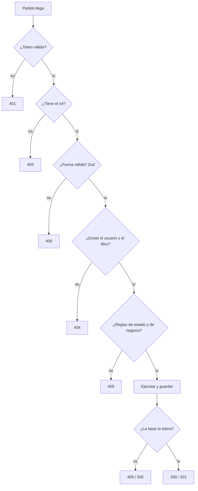
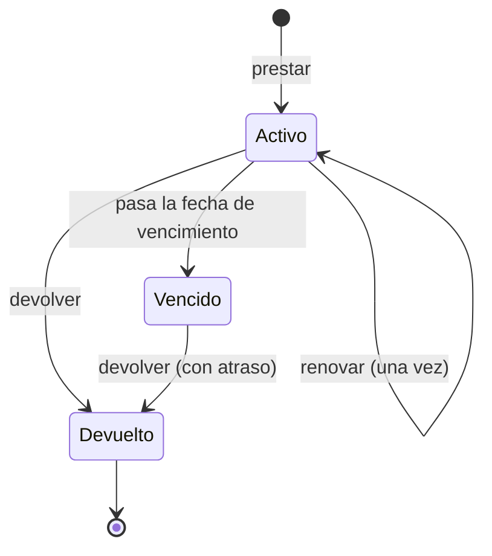

# Clase 13 — Reglas de negocio, validaciones cruzadas y repaso de status codes

## Objetivos de la clase

- Distinguir los **tipos de validación** (forma, existencia, permisos, reglas de negocio, integridad) y saber **en qué capa vive cada una** y en qué orden se chequean.
- Escribir **validaciones cruzadas**: entre campos de un mismo pedido (con `refine` de Zod) y entre entidades distintas (usuario + libro + préstamos).
- Implementar **reglas de negocio finas** sobre el módulo de préstamos: límite de préstamos activos, fecha de vencimiento en días hábiles, bloqueo por préstamos vencidos y renovación.
- Entender que algunos estados **se calculan y no se guardan** (un préstamo "vencido"), y por qué el **reloj** tiene que ser una dependencia inyectada.
- Reconocer las **condiciones de carrera** en las reglas del tipo "contar y después insertar", y cuál es la última línea de defensa.
- Repasar los **status codes** con criterio: cuándo `400`, `404`, `403`, `409`, `422` y los `5xx`.

*(Conecta con la clase 6: Zod y el error handler. Con la 7 y la 8: las reglas de negocio viven en los casos de uso y no en los controllers. Con la 11: la autorización por dueño ("solo lo mío") ya fue una regla de negocio. Con la 12: los feriados llegan con el mismo patrón de gateway y los `502`/`504` que vimos ahí se repasan hoy. Con la 14: todo lo que hoy escribamos como función pura se testea sin infraestructura.)*

---

## 1. la situación: la biblioteca funciona, pero todavía no se comporta como una biblioteca

Veamos cómo se comporta hoy el módulo de préstamos, y si te parece razonable:

- Un usuario puede pedir **100 libros** a la vez.
- Un préstamo **no vence nunca**: no hay fecha límite para devolver.
- Un socio que tiene un libro hace **seis meses** puede seguir pidiendo más.
- Si alguien quiere quedarse un libro un tiempo más, no puede: solo devolverlo y volver a pedirlo.

Todo eso "funciona" en el sentido técnico: no hay errores ni excepciones. Pero ninguna biblioteca real opera así. Lo que falta no es infraestructura, son **reglas de negocio**: las normas propias del dominio que dicen qué está permitido y qué no.

Estas son las que vamos a implementar:

| #  | Regla                                                                                       | Si se rompe                                                             |
| -- | ------------------------------------------------------------------------------------------- | ----------------------------------------------------------------------- |
| R1 | Un usuario puede tener **como máximo 3 préstamos activos**                          | `409 LOAN_LIMIT_REACHED`                                              |
| R2 | Todo préstamo **vence a los 10 días hábiles** (sin sábados, domingos ni feriados) | — (se calcula)                                                         |
| R3 | Un usuario con **algún préstamo vencido** no puede pedir libros nuevos              | `409 USER_HAS_OVERDUE_LOANS`                                          |
| R4 | Un préstamo se puede **renovar una sola vez**, si no está vencido ni devuelto       | `409 RENEWAL_LIMIT_REACHED` / `LOAN_OVERDUE` / `ALREADY_RETURNED` |
| R5 | El **ISBN** de un libro debe tener un **dígito de control válido**            | `400` (validación de forma)                                          |

Lo interesante es que **ninguna de estas reglas se puede resolver mirando un solo dato**: R1 necesita contar los préstamos del usuario, R3 necesita mirar sus fechas, R4 necesita el estado del préstamo y cuántas veces se renovó. Eso es lo que llamamos validaciones **cruzadas**.

---

## 2. tipos de validación y en qué capa vive cada una

La palabra "validar" mezcla cosas muy distintas. Conviene separarlas:

| Tipo                                | Pregunta que responde                     | Ejemplo                                               | Dónde vive                    | Código                 |
| ----------------------------------- | ----------------------------------------- | ----------------------------------------------------- | ------------------------------ | ----------------------- |
| **Forma**                     | ¿El pedido tiene la estructura correcta? | `stock` es un número, `email` parece un email    | Schema de Zod en el router     | `400`                 |
| **Autenticación**            | ¿Quién sos?                             | Token presente y firmado                              | Middleware                     | `401`                 |
| **Autorización**             | ¿Tenés permiso para esta operación?    | Solo el admin crea libros                             | Middleware o caso de uso       | `403`                 |
| **Existencia**                | ¿Lo que mencionás existe?               | El libro `999`                                      | Caso de uso                    | `404`                 |
| **Estado / regla de negocio** | ¿La operación tiene sentido *ahora*?  | El libro no tiene stock; el préstamo ya fue devuelto | **Caso de uso**          | `409`                 |
| **Integridad**                | ¿La base lo tolera?                      | Email único, claves foráneas                        | La base de datos (constraints) | `409` (si se traduce) |

Una regla práctica para decidir dónde va cada cosa:

- Si se puede decidir **mirando solo el pedido** (sin consultar nada), es de **forma** y va en Zod.
- Si hace falta **consultar datos** (la base, otra API, la fecha de hoy), es de **negocio** y va en el **caso de uso**.
- Si tiene que valer **aunque alguien se saltee la API** (un script, otro servicio), es de **integridad** y además va como constraint en la base.

### El orden importa

Los chequeos se hacen del más barato al más caro, y cortando en cuanto uno falla (*fail fast*):

*(si tu editor no renderiza Mermaid, instalá la extensión "Markdown Preview Mermaid Support" en VSCode, o mirá el archivo directamente en GitHub)*



Hacerlo en este orden tiene una razón práctica: no tiene sentido consultar la base para saber si el libro existe si el JSON ni siquiera tiene `bookId`. Y tiene una razón de seguridad: no queremos contarle a alguien sin permiso si un recurso existe o no (lo vemos en la sección 8).

---

## 3. validaciones cruzadas

### 3.1. Entre campos del mismo pedido: `refine` de Zod

A veces cada campo es válido por separado pero **la combinación no**. El ejemplo clásico es un rango de fechas: `desde` y `hasta` son fechas válidas, pero `desde` no puede ser posterior a `hasta`.

Imaginá que queremos filtrar el historial de préstamos por fecha: `GET /loans?desde=2026-10-01&hasta=2026-10-31`.

```js
// schemas/loanSchema.js
const dateOnly = z.iso.date({ error: "La fecha debe tener formato AAAA-MM-DD" });

const queryLoansSchema = z
  .object({
    userId: z.coerce.number().int().positive().optional(),
    desde: dateOnly.optional(),
    hasta: dateOnly.optional(),
  })
  .refine((q) => !q.desde || !q.hasta || q.desde <= q.hasta, {
    message: "'desde' no puede ser posterior a 'hasta'",
    path: ["desde"], // en qué campo se informa el error
  });
```

Fijate que `refine` recibe el objeto **completo** ya parseado (por eso puede comparar dos campos) y que el `path` hace que el error aparezca en el campo correcto dentro de `details`. Las cadenas `AAAA-MM-DD` se pueden comparar con `<=` directamente porque ordenan igual que las fechas.

Para varios chequeos sobre el mismo objeto, o para mensajes distintos según el caso, existe `superRefine`, que permite agregar varios errores.

### 3.2. Una regla fina de forma: el dígito de control del ISBN

En la clase 12 vimos que el ISBN-13 tiene un último dígito que se calcula a partir de los otros doce. Hoy nuestro esquema solo mira que sean 13 dígitos: un ISBN inventado pasa. Es una validación de **forma** (se decide mirando solo el dato) pero **más fina** que una expresión regular:

```js
// utils/isbn.js
// Se multiplican los primeros 12 dígitos alternando por 1 y por 3, se suman,
// y el dígito de control es lo que falta para llegar a la decena siguiente.
function hasValidIsbn13Checksum(isbn) {
  const digits = [...isbn].map(Number);
  const sum = digits.slice(0, 12).reduce((acc, d, i) => acc + d * (i % 2 === 0 ? 1 : 3), 0);
  return (10 - (sum % 10)) % 10 === digits[12];
}

// schemas/bookSchema.js
isbn: z
  .string()
  .regex(/^\d{13}$/, "El ISBN debe tener exactamente 13 dígitos")
  .refine(hasValidIsbn13Checksum, "El ISBN tiene un dígito de control inválido"),
```

Dos pasos encadenados: primero la forma (13 dígitos) y recién después la cuenta. Es la misma lógica de un CUIT o de un número de tarjeta: se valida **localmente**, sin llamar a ninguna API, y así se atrapan los errores de tipeo antes de que lleguen a la base.

### 3.3. Entre entidades: es trabajo del caso de uso

Acá `refine` ya no alcanza, porque para decidir hay que **consultar datos**. "El usuario ya tiene 3 préstamos" no se puede saber con el JSON del pedido. Estas reglas viven en el caso de uso:

```js
// usecases/loans/createLoan.js (esquema simplificado)
const user = await usersDao.getById(userId);           // existencia → 404
const book = await booksDao.getById(bookId);           // existencia → 404

const activeLoans = await loansDao.getAll({ userId, activos: true });
if (activeLoans.length >= maxActiveLoans) {            // regla R1 → 409
  throw new AppError("LOAN_LIMIT_REACHED", `Un usuario puede tener hasta ${maxActiveLoans} préstamos activos`, 409);
}
```

El caso de uso es el único lugar con acceso a **todos** los DAOs a la vez. Por eso las reglas que cruzan entidades ocurren ahí y no en el controller (que solo traduce HTTP) ni en el DAO (que solo persiste).

---

## 4. las reglas finas, una por una

### 4.1. R1 — Límite de préstamos activos

Ya está esbozada arriba. Dos detalles de diseño:

- El tope **no está escrito en el código**: es configuración (`LOAN_MAX_ACTIVE=3`) que llega por inyección. Mañana la biblioteca decide que son 5 y se cambia una variable de entorno, no el código.
- El mensaje dice **cuál es el límite**: sirve para que quien consume la API (o la persona que mira la pantalla) entienda el motivo sin tener que adivinar.

### 4.2. R2 — Fecha de vencimiento en días hábiles

Cada préstamo guarda ahora su `fechaVencimiento`. Y no son "10 días corridos": son **10 días hábiles**, es decir sin contar sábados, domingos ni feriados.

Esto es una **función pura**: recibe datos y devuelve un resultado, sin leer la base, ni la hora, ni la red. Por eso es fácil de entender y de testear:

```js
// domain/businessDays.js
// Fechas como texto "AAAA-MM-DD" (sin hora): evitamos los problemas de zona horaria.
function addBusinessDays(startDate, days, holidays) {
  const holidaySet = new Set(holidays);       // búsqueda rápida
  const date = new Date(`${startDate}T00:00:00Z`);
  let remaining = days;

  while (remaining > 0) {
    date.setUTCDate(date.getUTCDate() + 1);   // avanzamos un día
    const dayOfWeek = date.getUTCDay();        // 0 = domingo, 6 = sábado
    const iso = date.toISOString().slice(0, 10);
    if (dayOfWeek !== 0 && dayOfWeek !== 6 && !holidaySet.has(iso)) {
      remaining--;                             // solo cuenta si es hábil
    }
  }
  return date.toISOString().slice(0, 10);
}
```

Un detalle que parece menor y no lo es: **trabajamos con fechas como texto `AAAA-MM-DD`**, no con objetos `Date` con hora. Si guardáramos un instante y lo comparáramos, "hoy a las 23:30 en Argentina" ya es "mañana" en UTC, y un préstamo podría figurar como vencido unas horas antes de tiempo. Para "días" (no momentos) se usa una fecha sin hora, y se fija **una sola zona horaria** para saber qué día es "hoy".

### 4.3. Los feriados: un segundo gateway

¿De dónde salen los feriados? De una API pública (ArgentinaDatos), con el mismo patrón de la clase 12:

```
GET https://api.argentinadatos.com/v1/feriados/2026
→ [{ "fecha": "2026-10-12", "tipo": "trasladable", "nombre": "Día del Respeto a la Diversidad Cultural" }, ...]
```

Lo que cambia respecto de la clase 12:

|                   | Catálogo de libros (clase 12)                 | Feriados (hoy)                                                      |
| ----------------- | ---------------------------------------------- | ------------------------------------------------------------------- |
| ¿Cambia seguido? | Poco, pero hay muchísimos ISBN                | **Casi nunca**: una vez por año                              |
| Caché            | No conviene (rompe la comparación didáctica) | **Sí conviene**: se pide una vez por año y se guarda        |
| Si la API falla   | Se muestra lo local                            | Se calcula **sin feriados** (solo fines de semana) y se avisa |

Es otra oportunidad de **degradación elegante**: que una API de terceros esté caída no debería impedir prestar un libro. Pero tampoco hay que esconderlo: el préstamo se crea con un vencimiento que puede estar corrido uno o dos días, y la respuesta lo indica (`holidaysAvailable: false`) para que alguien pueda revisarlo.

El gateway respeta un contrato mínimo, igual que el catálogo, y tiene una versión falsa para clase y para testear:

```js
// contrato: getHolidays(year) → ["2026-01-01", "2026-02-16", ...]
```

> **Una decisión de negocio, no técnica:** la API marca algunos días como `puente` (no laborables, pero optativos para el empleador). ¿La biblioteca cierra? Eso lo decide la biblioteca, no el programador. Nosotros los contamos como no hábiles, y lo dejamos documentado, porque el código tiene que reflejar una decisión explícita y no una suposición.

### 4.4. R3 — Un préstamo vencido es un estado *calculado*

¿Cómo sabemos que un préstamo está vencido? La tentación es agregar una columna `estado` con los valores `activo`, `vencido` y `devuelto`. Pero entonces alguien tendría que **actualizarla**: un proceso programado que cada noche revise los préstamos y cambie el estado. Si ese proceso falla un día, la base miente.

La alternativa: **no guardar lo que se puede calcular**.

```js
// Un préstamo está vencido si NO se devolvió y su fecha límite ya pasó
const isOverdue = (loan, today) => loan.fechaDevolucion === null && loan.fechaVencimiento < today;
```

*(si tu editor no renderiza Mermaid, instalá la extensión "Markdown Preview Mermaid Support" en VSCode, o mirá el archivo directamente en GitHub)*



Fijate qué se guarda y qué se calcula:

| Dato                                                                           | ¿Se guarda? | Por qué                                       |
| ------------------------------------------------------------------------------ | ------------ | ---------------------------------------------- |
| `fechaPrestamo`, `fechaDevolucion`, `fechaVencimiento`, `renovaciones` | Sí          | Son hechos: pasaron, no cambian solos          |
| "Está vencido"                                                                | **No** | Depende de qué día es hoy; se deriva         |
| "Días de atraso"                                                              | **No** | `hoy − fechaVencimiento`, también derivado |

Con esto la regla R3 se escribe sola:

```js
const overdue = activeLoans.filter((loan) => isOverdue(loan, clock.today()));
if (overdue.length > 0) {
  throw new AppError("USER_HAS_OVERDUE_LOANS", "Tenés préstamos vencidos: devolvelos antes de pedir otros", 409);
}
```

### 4.5. El reloj es una dependencia

Mirá la línea anterior: `clock.today()`. ¿Por qué no `new Date()` directamente? Porque **la hora es un dato externo**, igual que una base de datos o una API. Una regla que depende de `new Date()` es imposible de probar: para verificar que "un préstamo de hace 3 semanas está vencido" habría que esperar 3 semanas, o hackear el sistema.

La solución es la misma de siempre: **inyectarla**.

```js
// utils/clock.js
function createClock({ fixedNow } = {}) {
  const now = () => (fixedNow ? new Date(fixedNow) : new Date());
  return {
    now,
    // "Hoy" como AAAA-MM-DD, siempre en la zona horaria de la biblioteca
    today: () => new Intl.DateTimeFormat("en-CA", { timeZone: "America/Argentina/Buenos_Aires" }).format(now()),
  };
}
```

- En producción el reloj devuelve la hora real.
- En un test (clase 14) se le pasa una fecha fija, y los resultados son siempre los mismos.
- Para probar a mano con el `.http`, se puede arrancar el servidor con `CLOCK_NOW=2026-12-01T12:00:00Z` y "viajar en el tiempo" para ver cómo se comporta un préstamo vencido.

Un caso de uso que no llama a `new Date()` ni a `fetch` ni a la base, sino que recibe todo por parámetro, es **determinista**: mismas entradas, misma salida. Es la propiedad que más facilita testear.

### 4.6. R4 — Renovar un préstamo

`PUT /loans/:id/renew` extiende el plazo. Es el mejor ejemplo de que **una regla de negocio suele ser una cadena de condiciones**, cada una con su propio error:

```js
// usecases/loans/renewLoan.js (esquema)
const loan = await loansDao.getById(id);
if (!loan) throw new AppError("LOAN_NOT_FOUND", "...", 404);                          // existencia
if (actor.rol !== "admin" && loan.userId !== actor.id) throw new AppError("FORBIDDEN", "...", 403);  // permiso
if (loan.fechaDevolucion) throw new AppError("ALREADY_RETURNED", "...", 409);        // estado
if (isOverdue(loan, clock.today())) throw new AppError("LOAN_OVERDUE", "...", 409);  // estado
if (loan.renovaciones >= maxRenewals) throw new AppError("RENEWAL_LIMIT_REACHED", "...", 409);  // regla

// El nuevo vencimiento se cuenta desde el actual (no desde hoy)
const holidays = await holidaysFor(loan.fechaVencimiento);
const newDueDate = addBusinessDays(loan.fechaVencimiento, loanBusinessDays, holidays);
return loansDao.renew(id, newDueDate);
```

Fijate el **orden**: es el de la sección 2. Existencia, permisos, estado, regla. Y que cada falla tiene un `code` propio: quien consume la API puede mostrar un mensaje distinto para cada situación sin tener que leer el texto del error.

---

## 5. concurrencia: la regla que se rompe con dos pedidos a la vez

R1 dice "como máximo 3 préstamos activos". La implementación obvia:

```js
const active = await loansDao.getAll({ userId, activos: true });   // 1. cuento
if (active.length >= 3) throw ...;
await loansDao.lend({ userId, bookId });                           // 2. inserto
```

Funciona perfecto con **un** pedido por vez. Pero ¿qué pasa si el mismo usuario manda **dos pedidos al mismo tiempo** cuando ya tiene 2 préstamos?

```
pedido A: cuenta → 2   (ok, falta uno)
pedido B: cuenta → 2   (ok, falta uno)      ← lee antes de que A inserte
pedido A: inserta      → 3 préstamos
pedido B: inserta      → 4 préstamos        ← la regla se rompió
```

Es una **condición de carrera** (*race condition*): entre "mirar" y "escribir" otro pedido se coló. Node tiene un solo hilo, pero cada `await` es un punto donde otro pedido puede avanzar.

Hay tres defensas, de menor a mayor garantía:

| Defensa                         | Cómo                                            | Alcance                                                          |
| ------------------------------- | ------------------------------------------------ | ---------------------------------------------------------------- |
| Chequear en el caso de uso      | Lo que ya hicimos                                | Cubre el 99% de los casos, **no** los pedidos simultáneos |
| **Constraint en la base** | Un índice único que impida el duplicado        | Garantía real, la hace la base                                  |
| **Operación atómica**   | Una transacción, o un `UPDATE` con condición | Mira y escribe en un solo paso                                   |

Ya usamos las dos últimas en la clase 10: el stock se descuenta con un `UPDATE ... WHERE stock > 0` (la condición y la escritura son una sola operación), y todo el préstamo ocurre dentro de una transacción. Para el caso de "no pedir dos veces el mismo libro sin devolverlo" (`ALREADY_LOANED`) el chequeo del caso de uso se refuerza con un **índice único parcial** en la base:

```js
// dao/models/LoanModel.js
indexes: [
  // Un usuario no puede tener dos préstamos ACTIVOS del mismo libro
  { unique: true, fields: ["userId", "bookId"], where: { fechaDevolucion: null } },
],
```

> **La idea general:** las reglas de negocio en el caso de uso dan **buenos mensajes de error**; las constraints de la base dan **garantías**. Se necesitan las dos: la primera para que el usuario entienda qué pasó, la segunda para que ningún bug ni pedido simultáneo pueda violar la regla.

> **Una advertencia sobre `sync({ alter: true })`.** Hasta la clase 12 el proyecto sincronizaba las tablas con `alter: true`. En SQLite eso **recrea las tablas** `users` y `books` para adaptarlas al modelo, y como `loans` tiene claves foráneas con `ON DELETE CASCADE`, **los préstamos se borraban en cada reinicio del servidor** (mientras el stock seguía descontado: aparecía un `OUT_OF_STOCK` inexplicable). Además, con un índice único compuesto, `alter` deja las columnas como `UNIQUE` y ya no se puede volver a prestar un libro devuelto. Por eso desde hoy el proyecto usa `sync()` simple, que solo crea lo que falta. La contracara: si cambia el esquema de un modelo, en desarrollo se borra `database.sqlite`; en un sistema real se usan **migraciones**, que quedan fuera del curso. La lección general: **una herramienta que "arregla sola" la base de datos también puede romperla sola.**

Para el tope de 3 préstamos, que no se puede expresar con un índice, la forma robusta es hacer el conteo y el insert **dentro de la misma transacción**. Lo dejamos como ejercicio avanzado.

---

## 6. repaso de status codes

Después de 12 clases ya usamos casi todos. Ahora los ordenamos con criterio. La regla de oro: el código **le dice al cliente de quién es el problema y qué puede hacer**.

### Las familias

| Familia       | Significado                                   | Quién tiene el problema                |
| ------------- | --------------------------------------------- | --------------------------------------- |
| **2xx** | Salió bien                                   | —                                      |
| **4xx** | El **cliente** hizo algo mal            | Quien llama (reintentar igual no sirve) |
| **5xx** | Falló el **servidor** (o lo de atrás) | Nosotros (reintentar puede servir)      |

### Los de éxito

| Código                  | Cuándo                                          | En nuestra API                                                                                            |
| ------------------------ | ------------------------------------------------ | --------------------------------------------------------------------------------------------------------- |
| **200 OK**         | Salió bien y hay cuerpo                         | `GET`, `PUT`                                                                                          |
| **201 Created**    | Se **creó** un recurso                    | `POST /books`, `POST /loans`. Lo ideal es agregar el header `Location` con la URL del nuevo recurso |
| **202 Accepted**   | Lo recibí pero lo **proceso después**    | Una importación de 500 libros en segundo plano                                                           |
| **204 No Content** | Salió bien y **no hay nada que devolver** | `DELETE`, `PUT /auth/password`                                                                        |

### Los de error del cliente: el criterio

| Código                             | Significa                                                      | Usalo cuando                                                    | Ejemplo nuestro                                                  |
| ----------------------------------- | -------------------------------------------------------------- | --------------------------------------------------------------- | ---------------------------------------------------------------- |
| **400 Bad Request**           | El pedido está **mal formado**                          | JSON roto, campo faltante o con tipo incorrecto, regla de forma | Zod rechaza el body                                              |
| **401 Unauthorized**          | **No sabemos quién sos** (falta autenticación)         | Sin token, token inválido o vencido                            | `TOKEN_MISSING`                                                |
| **403 Forbidden**             | Sé quién sos, pero **no tenés permiso**               | Rol insuficiente o el recurso no es tuyo                        | Un lector crea un libro                                          |
| **404 Not Found**             | **No existe**                                            | El id no corresponde a nada                                     | `BOOK_NOT_FOUND`                                               |
| **409 Conflict**              | El pedido es válido pero **choca con el estado actual** | Duplicados, reglas de negocio de estado                         | `ISBN_DUPLICATE`, `LOAN_LIMIT_REACHED`, `ALREADY_RETURNED` |
| **422 Unprocessable Content** | Bien formado, pero **semánticamente inválido**         | Combinaciones de campos imposibles                              | `desde` posterior a `hasta`                                  |
| **429 Too Many Requests**     | Demasiados pedidos                                             | Rate limit                                                      | Muchos logins fallidos                                           |

Los tres que más se confunden:

- **400 vs 422.** Los dos significan "tu pedido está mal". Muchas APIs usan `400` para todo, otras reservan `422` para los errores de significado. Ninguna es incorrecta: **lo importante es elegir una convención y mantenerla**. En este proyecto usamos `400` para todo lo que valida Zod, y `409` para lo que depende del estado.
- **400 vs 409.** `400`: "el pedido está mal, no importa cuándo lo hagas". `409`: "el pedido está bien, pero **ahora** no se puede". Prestar un libro sin stock es un `409`: si mañana hay stock, el *mismo* pedido funcionaría.
- **401 vs 403.** Se resuelve con una pregunta: *¿sabemos quién sos?* Si no → `401`. Si sí, pero no podés → `403`. (El nombre `Unauthorized` es un error histórico: en realidad significa "no autenticado".)

### Los de error del servidor

| Código                             | Cuándo                                                      | En nuestra API                                                          |
| ----------------------------------- | ------------------------------------------------------------ | ----------------------------------------------------------------------- |
| **500 Internal Server Error** | Algo falló **de nuestro lado** y no lo previmos       | Un bug; el `errorHandler` devuelve un mensaje genérico y no detalles |
| **502 Bad Gateway**           | **Un tercero** respondió mal o no pudimos conectarnos | `EXTERNAL_API_ERROR` (clase 12)                                       |
| **503 Service Unavailable**   | Estamos **temporalmente** fuera de servicio            | Mantenimiento, sobrecarga                                               |
| **504 Gateway Timeout**       | **Un tercero** no respondió a tiempo                  | `EXTERNAL_TIMEOUT` (clase 12)                                         |

### Casos que generan debate

**¿404 o 403 cuando el recurso es de otro?** Hoy, si un lector pide `GET /loans/5` y ese préstamo es de otra persona, respondemos `403`. Eso le confirma que el préstamo 5 **existe**. Si queremos no revelar ni eso, se responde `404`: "para vos, ese recurso no existe". Es un *trade-off*: el `403` es más claro para depurar, el `404` es más discreto. Lo importante es saber que es una decisión y tomarla a conciencia.

**¿Qué responder si devuelven dos veces el mismo libro?** Hoy, `409 ALREADY_RETURNED`. Otra postura posible es responder `200` otra vez (que la operación sea *idempotente*: repetirla no cambia el resultado). Cuál conviene depende de si al cliente le sirve saber que ya estaba hecho. Lo que no se debe hacer es responder `500`.

**¿Cuándo `200` y cuándo `201`?** `201` solo cuando se **creó** algo. `PUT /loans/:id/return` modifica un préstamo existente: es `200`. `POST /books/import` (clase 12) no crea "un recurso" sino que ejecuta una operación: `200` con un informe.

**Mensaje, `code` y status: tres cosas distintas.**

```json
{ "error": { "code": "LOAN_LIMIT_REACHED", "message": "Un usuario puede tener hasta 3 préstamos activos" } }
```

- El **status** (`409`) lo entiende cualquier cliente HTTP.
- El **`code`** es un identificador estable para que el código del cliente decida qué hacer (`if (error.code === "LOAN_LIMIT_REACHED") ...`). **No debería cambiar nunca.**
- El **`message`** es texto para humanos, se puede reescribir o traducir sin romper a nadie. Un cliente que compara mensajes está mal hecho.

Existe un estándar para este formato (RFC 9457, *Problem Details*), parecido al que ya usamos.

---

## 7. cableado

Nada de esto cambia el Composition Root más que lo justo: lo nuevo se **suma** sin tocar lo anterior.

```js
// container/container.js
const clock = createClock({ fixedNow: CLOCK_NOW });          // real o fijo (para probar)
const holidays = getHolidaysGateway();                        // API real o falsa, según HOLIDAYS_TYPE

const loanRules = {
  maxActive: LOAN_MAX_ACTIVE,                                 // 3
  businessDays: LOAN_BUSINESS_DAYS,                           // 10
  maxRenewals: LOAN_MAX_RENEWALS,                             // 1
};

makeLoanUseCases({ loansDao, booksDao, usersDao, events, clock, holidays, loanRules });
```

Observá que las **reglas** (los números) son configuración, el **reloj** y los **feriados** son dependencias inyectadas, y la **lógica de calendario** es una función pura. Los casos de uso se pueden leer de arriba a abajo sin ver `process.env`, `new Date()` ni `fetch`.

---

## 8. cómo se prueba una regla de negocio

Una regla se prueba con **escenarios**: se arma una situación, se ejecuta una acción, se verifica la respuesta. Para cada regla hay que probar:

1. **El caso feliz**: la regla se cumple y todo sale bien.
2. **El borde**: justo en el límite (el préstamo número 3 sí, el 4 no). Los bugs viven en los bordes.
3. **El caso que la viola**: y que el código de error sea el esperado.
4. **Que el estado no cambió**: tras un rechazo, el stock y los préstamos quedaron igual.

Ejemplo para R1, en el `.http`:

```
1. Prestar el libro 1 al usuario Ana        → 201
2. Prestar el libro 2 a Ana                 → 201
3. Prestar el libro 3 a Ana                 → 201   (tercer préstamo: justo el límite)
4. Prestar el libro 4 a Ana                 → 409 LOAN_LIMIT_REACHED
5. Verificar que el stock del libro 4 no cambió
```

Las reglas que dependen de la fecha (R3, R4) son más difíciles con el `.http`, porque hay que "esperar" a que algo venza. Ahí aparece el reloj inyectable: se arranca el servidor con `CLOCK_NOW` en una fecha futura y se observa el comportamiento. Y en la clase 14, con tests automáticos, se le pasa directamente una fecha fija a cada escenario.

---

## 9. errores comunes

| Error                                                 | Consecuencia                         | Qué hacemos                           |
| ----------------------------------------------------- | ------------------------------------ | -------------------------------------- |
| Poner reglas de negocio en el controller              | No se reusan ni se testean           | En el caso de uso                      |
| Poner todas las reglas en Zod                         | Zod no puede consultar la base       | Forma en Zod, estado en el caso de uso |
| Usar `new Date()` dentro de la regla                | No se puede probar                   | Reloj inyectado                        |
| Guardar un estado que se puede calcular (`vencido`) | Se desactualiza                      | Derivarlo                              |
| Comparar fechas con horas y zonas horarias            | Vence unas horas antes o después    | Fechas `AAAA-MM-DD` y una zona fija  |
| Número mágico dentro del código (`if (n >= 3)`)  | Cambiar la regla exige tocar código | Configuración inyectada               |
| Un solo error genérico para todos los fallos         | El cliente no puede reaccionar       | Un `code` por cada situación        |
| Responder `200` con `{ "error": ... }`            | El cliente cree que salió bien      | El status code correcto                |
| Responder `500` ante un error del cliente           | Parece un bug nuestro                | `4xx`                                |
| Confiar solo en el chequeo del caso de uso            | Se rompe con pedidos simultáneos    | Constraint o transacción además      |
| Que una API de terceros caída bloquee algo crítico  | Pérdida de disponibilidad           | Degradación elegante                  |

---

## 10. lo que NO vimos (y que existe)

- **Máquinas de estado formales**: modelar los estados y las transiciones permitidas de forma explícita (en lugar de un `if` por cada caso).
- **Reservas y lista de espera**: si no hay stock, anotarse para cuando se devuelva. Cruza reglas con eventos (clase 10).
- **Multas y sanciones**: suspender al socio unos días por devolver tarde, o cobrarle.
- **Claves de idempotencia** (`Idempotency-Key`): para que un `POST` repetido por un reintento de red no cree dos préstamos.
- **Bloqueo optimista** (`version`): detectar que dos personas editaron el mismo registro a la vez.
- **Calendarios por región y por sede**: los feriados varían por provincia, y cada sucursal puede cerrar en días distintos.
- **Domain events** más ricos: `loan.overdue`, `loan.renewed`, con avisos por mail al socio.

---

## Cierre

- Validar no es una sola cosa: **forma** (Zod), **permisos** (middleware), **existencia** y **reglas de negocio** (caso de uso), **integridad** (la base). Cada una en su capa y chequeadas de la más barata a la más cara.
- Las validaciones **cruzadas** entre campos van en `refine`; las que cruzan **entidades** van en el caso de uso, que es el único con acceso a todos los DAOs.
- Lo que se puede calcular **no se guarda** (un préstamo vencido), y lo que depende del tiempo necesita un **reloj inyectado**; si no, no se puede probar.
- Las reglas del tipo "contar y después insertar" tienen **condiciones de carrera**: el caso de uso da buenos mensajes, la base da garantías, y se necesitan las dos.
- El status code dice **de quién es el problema**: `400`/`422` pedido inválido, `404` no existe, `403` sin permiso, `409` choca con el estado, `502`/`504` falló un tercero. Y el `code` del error es el contrato estable.

La próxima clase (14) es de **calidad**: escribimos **tests automáticos** de los casos de uso con Jest o Vitest, sin base ni red. Todo lo que hoy diseñamos como función pura (`addBusinessDays`, `isOverdue`, el reloj fijo, los feriados falsos) es exactamente lo que se va a testear.
