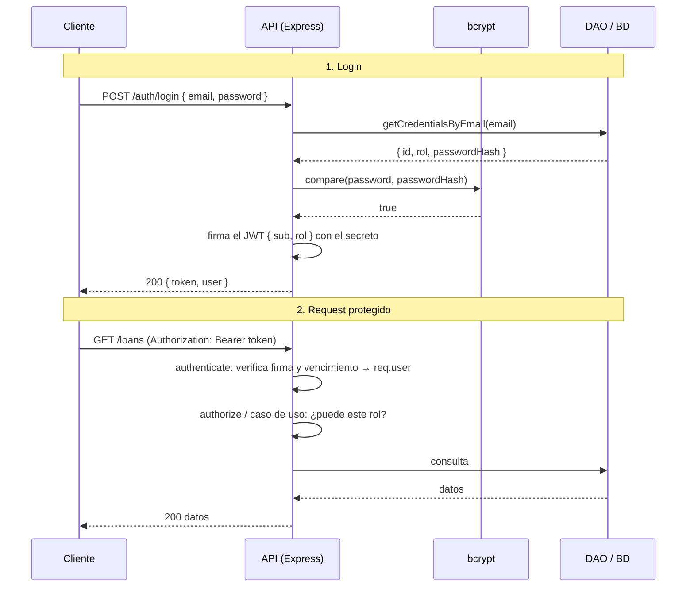

# Clase 11 — Seguridad: contraseñas con hash y autenticación con JWT

## Objetivos de la clase

- Distinguir cuatro cosas que se mezclan todo el tiempo: **encoding**, **hash**, **encriptación** y **firma**.
- Guardar contraseñas de forma segura con **bcrypt** (hash lento con salt) y entender por qué no sirve SHA-256.
- Entender qué es un **token JWT**, cómo está armado y qué garantiza (y qué *no*).
- Construir el flujo completo: **registro → login → token → rutas protegidas**.
- Separar **autenticación** (¿quién sos?) de **autorización** (¿qué podés hacer?) con dos middlewares.
- Mantener la arquitectura: el hasheo y los tokens son dependencias **inyectadas** desde el Composition Root, igual que el DAO y el notificador.

*(Conecta con la clase 6: la validación con Zod y el error handler se reutilizan. Con la 8 y la 10: el cableado vive en `container/container.js`. Con la 9: el DAO ya devuelve solo las columnas que le pedimos, y hoy eso se vuelve crítico. Con la 13: las reglas finas de acceso, como "un lector solo ve sus préstamos", son reglas de negocio.)*

---

## 1. el problema: la API está abierta

Hasta la clase 10 cualquiera que conozca la URL puede crear, modificar o borrar libros y usuarios. Para cerrar eso hay que resolver dos preguntas distintas:

| Pregunta                       | Nombre         | Cómo se resuelve hoy                                                   |
| ------------------------------ | -------------- | ----------------------------------------------------------------------- |
| **¿Quién sos?**        | Autenticación | Email + contraseña en el login, y después un token en cada request    |
| **¿Qué podés hacer?** | Autorización  | Mirando el `rol` del usuario ya identificado (`lector` o `admin`) |

Fijate el orden: primero se autentica, después se autoriza. Si no sabés quién es, no podés decidir qué le corresponde.

Un detalle de nombres que confunde a todos: un request sin credenciales recibe **401** (`Unauthorized`, que en realidad significa "no autenticado"). Un request con credenciales válidas pero sin permiso recibe **403** (`Forbidden`).

---

## 2. cuatro conceptos que no son lo mismo

Antes de escribir código hay que tener claro con qué herramienta se resuelve cada cosa.

| Concepto                                  | Qué hace                                | ¿Se revierte?             | Para qué sirve                                 |
| ----------------------------------------- | ---------------------------------------- | -------------------------- | ----------------------------------------------- |
| **Encoding** (base64, URL-encoding) | Cambia la *representación* de un dato | Sí, cualquiera, sin clave | Transportar datos. **No protege nada**    |
| **Hash** (bcrypt, argon2, SHA-256)  | Huella de una sola vía                  | No                         | Verificar sin guardar el original: contraseñas |
| **Encriptación** (AES)             | Oculta un dato con una clave             | Sí, con la clave          | Datos que después necesitás volver a leer     |
| **Firma** (HMAC, RSA)               | Prueba que nadie modificó el dato       | No oculta nada             | Es lo que usa JWT                               |

### cada concepto, fuera del código

- **Encoding → el braille (o el Morse).** Pasar "hola" a puntitos en relieve no esconde nada: cualquiera que conozca la tabla lo lee, y no hace falta ninguna clave. Solo cambia la *forma* para que el mensaje viaje por otro canal (el tacto, un telégrafo, una URL). Si alguien te dice que "protegió" algo con base64, es como decir que protegió una carta escribiéndola en braille.
- **Hash → la huella dactilar.** Del dedo sale una huella, pero de la huella no se reconstruye el dedo. Sirve para *comprobar* ("¿esta huella coincide con la que tengo guardada?"), no para recuperar el original.
- **Encriptación → una caja fuerte.** Guardás algo adentro y solo lo recupera quien tiene la llave. Es reversible a propósito.
- **Firma → el sello de lacre de una carta.** La carta se puede leer, pero si el sello está roto sabés que alguien la abrió o la cambió. Así funciona un JWT.

Podés verlo en la terminal:

```js
// concepts.js
import {
  createHash,
  createCipheriv,
  createDecipheriv,
  randomBytes,
  createHmac,
  timingSafeEqual,
} from "node:crypto";

// 1. Encoding: base64 se revierte con una línea, no hay secreto
const encoded = Buffer.from("hola").toString("base64");
const decoded = Buffer.from(encoded, "base64").toString();
console.log("encoding:", encoded, "→", decoded); // aG9sYQ== → hola

// 2. Hash: mismo input, mismo output, y no hay forma de volver. Solo se puede VERIFICAR.
const sha = (text) => createHash("sha256").update(text).digest("hex");
const stored = sha("hola");
console.log("hash:", stored);
console.log("¿'hola' coincide?", sha("hola") === stored);   // true
console.log("¿'Hola' coincide?", sha("Hola") === stored);   // false: cambiar una letra cambia todo el hash

// 3. Encriptación: con la clave se recupera el original (es reversible a propósito)
const key = randomBytes(32);
const iv = randomBytes(16);
const cipher = createCipheriv("aes-256-cbc", key, iv);
const encrypted = cipher.update("hola", "utf8", "hex") + cipher.final("hex");
console.log("encriptado:", encrypted);

const decipher = createDecipheriv("aes-256-cbc", key, iv);
const recovered = decipher.update(encrypted, "hex", "utf8") + decipher.final("utf8");
console.log("desencriptado con la clave:", recovered); // hola

// Con otra clave NO se puede recuperar
try {
  const wrong = createDecipheriv("aes-256-cbc", randomBytes(32), iv);
  const garbage = wrong.update(encrypted, "hex", "utf8") + wrong.final("utf8");
  console.log("con otra clave: basura, no el original →", JSON.stringify(garbage));
} catch {
  console.log("con otra clave: error, no se recupera");
}

// 4. Firma (HMAC): el texto queda visible, pero no se puede alterar sin la clave
const sign = (text, secret) => createHmac("sha256", secret).update(text).digest("hex");
const verify = (text, signature, secret) => {
  const expected = Buffer.from(sign(text, secret));
  const received = Buffer.from(signature);
  // timingSafeEqual compara en tiempo constante (no revela cuántos caracteres coinciden)
  return expected.length === received.length && timingSafeEqual(expected, received);
};

const signature = sign("hola", "mi-secreto");
console.log("firma:", signature);
console.log("¿válida?", verify("hola", signature, "mi-secreto"));            // true
console.log("¿texto alterado?", verify("hola!", signature, "mi-secreto"));   // false
console.log("¿otro secreto?", verify("hola", signature, "secreto-falso"));   // false
```

La regla que hay que llevarse: **una contraseña nunca se encripta, se hashea**. Si la encriptaras, alguien con la clave (o que robe la base y la clave juntas) podría leer todas. Con un hash, ni siquiera nosotros podemos saber cuál era la contraseña: solo podemos verificar si la que nos mandan produce el mismo hash.

---

## 3. contraseñas: hash, salt y por qué bcrypt

### Por qué no sirve SHA-256 (ni MD5)

SHA-256 está diseñado para ser **rápido**: una placa de video calcula miles de millones por segundo. Eso es excelente para verificar archivos y desastroso para contraseñas: si se filtra la base, un atacante prueba diccionarios enteros en minutos.

Hay dos defensas, y bcrypt trae las dos:

- **Salt**: un valor aleatorio distinto por cada usuario que se mezcla con la contraseña antes de hashear. Dos usuarios con la contraseña `Clave12345` terminan con hashes distintos, y un atacante no puede usar tablas precalculadas.
- **Costo ajustable (rounds)**: el hash es **lento a propósito**. Con cada `+1` de costo el cálculo tarda el doble. 10 rondas son unas decenas de milisegundos (según la máquina): imperceptible para un login, inviable para probar millones de combinaciones. Podés medirlo con `node scripts/hashDemo.js`, que además muestra por qué dos hashes de la misma contraseña son distintos.

### Anatomía de un hash bcrypt

```
$2b$10$N9qo8uLOickgx2ZMRZoMyeIjZAgcfl7p92ldGxad68LJZdL17lhWy
 │   │  └──────────── salt (22 caracteres) ──┘└─── hash ────────────┘
 │   └─ costo (10 rondas)
 └─ versión del algoritmo
```

El salt y el costo viajan **dentro** del propio hash. Por eso `compare` solo necesita la contraseña y el hash guardado: no hay una columna `salt` aparte.

### bcryptjs

```js
// security/passwordHasher.js
import bcrypt from "bcryptjs";

function createPasswordHasher({ rounds }) {
  return {
    hash: (plain) => bcrypt.hash(plain, rounds),
    compare: (plain, hash) => bcrypt.compare(plain, hash),
  };
}

export default createPasswordHasher;
```

Tres cosas para remarcar:

- Usamos la versión **asíncrona** (`hash`, no `hashSync`). El hash es CPU pura y la versión síncrona bloquea el event loop: mientras una persona se registra, nadie más recibe respuesta.
- Elegimos `bcryptjs` (JavaScript puro) y no `bcrypt` (módulo nativo): se instala sin compilar y funciona igual. En producción pesada se prefiere el nativo por velocidad.
- bcrypt solo procesa los **primeros 72 bytes** de la contraseña. Por eso el esquema Zod pone `max(72)`.

### El hasheador es una dependencia, no un import

Fijate que `createPasswordHasher` no lo importan los casos de uso: se crea en el contenedor y se **inyecta**. Es el mismo patrón del DAO y del notificador:

- El caso de uso depende de un contrato (`hash()` y `compare()`), no de bcryptjs.
- En la clase 14, al testear, le pasamos un hasheador falso que responde al instante.
- Si mañana se migra a argon2, cambia un archivo.

### ¿Y el hook `beforeCreate` de Sequelize?

Sequelize permite hashear dentro del modelo con un hook, y es la forma que muestra su documentación:

```js
UserModel.beforeCreate(async (user) => {
  user.password = await bcrypt.hash(user.password, 10);
});
```

Es cómodo, pero acá lo evitamos por varias razones:

- **Rompe el DAO intercambiable (clase 9).** El hook vive en el modelo de Sequelize. Con `PERSISTENCE_TYPE=memory` ese modelo no existe, y las contraseñas se guardarían en **texto plano**. Habría que repetir el hasheo en cada adaptador.
- **Esconde una regla de seguridad en el ORM.** Leyendo `createUser` no se ve que se hashea.
- **No se puede testear sin Sequelize.** Con el hasheador inyectado, en la clase 14 probamos `createUser` con uno falso, sin base de datos.
- **Tiene trampas.** `beforeCreate` no corre en `bulkCreate` ni en `Model.update` estático (salvo `individualHooks: true`), y en `beforeUpdate` hay que chequear `user.changed("password")` o se vuelve a hashear un hash ya hasheado.
- **No resuelve el login.** El `compare` igual tiene que hacerse fuera del modelo.

Si un proyecto está atado a un solo ORM y nunca va a cambiar de backend, el hook es una opción válida. Para este curso, donde la persistencia es intercambiable, el hasheo va en el caso de uso.

### Nunca devolver el hash

Esto conecta con la clase 9. Si el modelo tiene `passwordHash` y el DAO hace `findByPk(id)` sin `attributes`, Sequelize hace `SELECT *` y el hash sale en el JSON. Por eso:

- Todas las lecturas del DAO piden `attributes: USER_ATTRIBUTES`, que **no incluye** `passwordHash`.
- Hay **un único método** que lo devuelve: `getCredentialsByEmail`, que existe solo para el login.

```js
// dao/users/UsersSequelizeDao.js
const USER_ATTRIBUTES = ["id", "nombre", "email", "rol"];

// Credenciales para el login: es el ÚNICO método que devuelve el hash de la contraseña
async getCredentialsByEmail(email) {
  const user = await UserModel.findOne({
    where: { email },
    attributes: [...USER_ATTRIBUTES, "passwordHash"],
  });
  return user ? user.get({ plain: true }) : null;
}
```

El DAO en memoria hace lo mismo con un helper privado que quita el campo. Los dos adaptadores respetan el contrato, como siempre.

---

## 4. tokens y JWT

### El problema que resuelve

HTTP no tiene memoria: cada request llega "de cero". Si hiciéramos login con email y contraseña **en cada request**, tendríamos que mandar la contraseña todo el tiempo y correr bcrypt (lento) cada vez. Mejor: hacemos login **una vez**, el servidor nos entrega una "credencial temporal" y la mostramos en los pedidos siguientes. Esa credencial es el **token**.

### Qué es un JWT

Un JWT (*JSON Web Token*) son tres partes en base64url separadas por puntos:

```
eyJhbGciOiJIUzI1NiJ9 . eyJzdWIiOiIyIiwicm9sIjoibGVjdG9yIiwiZXhwIjoxNzYwfQ . 5mJc...
└──── header ───────┘   └──────────────── payload ─────────────────────┘   └ firma ┘
```

```js
// header: algoritmo de firma
{ "alg": "HS256", "typ": "JWT" }

// payload: los "claims" (afirmaciones)
{ "sub": "2", "rol": "lector", "iat": 1760000000, "exp": 1760003600 }
```

| Claim   | Significado                                                     |
| ------- | --------------------------------------------------------------- |
| `sub` | *Subject*: de quién es el token (el id del usuario)          |
| `iat` | *Issued at*: cuándo se emitió                               |
| `exp` | *Expiration*: cuándo vence                                   |
| `rol` | Claim propio nuestro, para no consultar la base en cada request |

La **firma** es un HMAC-SHA256 de `header.payload` usando el secreto del servidor. Si alguien cambia una letra del payload (por ejemplo `"rol": "admin"`), la firma deja de coincidir y el servidor rechaza el token.

### Lo que garantiza y lo que NO

| ✅ Garantiza                                         | ❌ No garantiza                                                                               |
| ---------------------------------------------------- | --------------------------------------------------------------------------------------------- |
| **Integridad**: el contenido no fue alterado   | **Confidencialidad**: cualquiera puede leer el payload (es base64, ¡pegalo en jwt.io!) |
| **Autoría**: lo firmó quien tiene el secreto | Que el usuario siga existiendo o conserve el rol                                              |
| **Vigencia**: se puede vencer (`exp`)        | Poder "des-emitirlo" antes de que venza (no hay logout real)                                  |

De ahí salen tres reglas:

1. **Nada sensible en el payload.** Ni contraseñas, ni datos personales. Solo `sub` y `rol`.
2. **El secreto es la llave maestra.** Quien lo conozca puede fabricar tokens de admin. Vive en `.env` (nunca en git) y debe ser largo y aleatorio. Por eso `config.js` **tira un error al arrancar** si `JWT_SECRET` no está definido, en lugar de usar un valor por defecto.
3. **Vida corta.** Como no se puede revocar, mientras menos dure, menos daño hace un token robado. Usamos `1h`.

### Sesión con estado vs. token sin estado

|                              | Sesión (cookie + id en servidor) | JWT                                     |
| ---------------------------- | --------------------------------- | --------------------------------------- |
| Dónde está la información | En el servidor (memoria/BD)       | En el propio token                      |
| Por request                  | El servidor busca la sesión      | El servidor solo verifica la firma      |
| Escalar a varios servidores  | Hay que compartir las sesiones    | Cualquier servidor con el secreto sirve |
| Cerrar sesión / revocar     | Se borra la sesión               | Difícil: hay que esperar al `exp`    |

Ninguno es "mejor". JWT encaja bien en APIs consumidas por distintos clientes (web, mobile), y es lo que se pide en el temario.

### Servicio de tokens

Igual que el hasheador, se crea en el contenedor y se inyecta:

```js
// security/tokenService.js
import jwt from "jsonwebtoken";
import AppError from "../errors/AppError.js";

function createTokenService({ secret, expiresIn }) {
  return {
    sign: (payload) => jwt.sign(payload, secret, { expiresIn }),

    verify(token) {
      try {
        // Fijamos el algoritmo para que nadie pueda cambiarlo desde el header del token
        return jwt.verify(token, secret, { algorithms: ["HS256"] });
      } catch (err) {
        if (err.name === "TokenExpiredError") {
          throw new AppError("TOKEN_EXPIRED", "El token venció, iniciá sesión de nuevo", 401);
        }
        throw new AppError("TOKEN_INVALID", "Token inválido", 401);
      }
    },
  };
}
```

Fijar `algorithms` evita el clásico ataque del header `"alg": "none"`: un token sin firma que una librería descuidada aceptaría.

---

## 5. ¿dónde guarda el token el front? body vs. cookie

Hay dos formas habituales de entregar el token, y es una decisión de diseño con trade-offs reales:

|                                   | En el body + header `Authorization: Bearer`                  | En una cookie `httpOnly`                                                  |
| --------------------------------- | -------------------------------------------------------------- | --------------------------------------------------------------------------- |
| Cómo lo manda el cliente         | A mano, en cada request (`fetch` con el header)              | El navegador la manda sola                                                  |
| Robo por XSS                      | **Vulnerable** si el front lo guarda en `localStorage` | Protegida: JavaScript no puede leerla                                       |
| Ataque CSRF                       | No aplica (el navegador no lo manda solo)                      | **Aplica**: hay que mitigarlo (`SameSite`, tokens CSRF)             |
| Clientes mobile / otros servicios | Natural                                                        | Incómodo                                                                   |
| Qué necesita el backend          | Nada extra                                                     | `cookie-parser`, `CORS` con credenciales, flags `Secure`/`SameSite` |

En esta clase usamos **body + `Authorization: Bearer`**, porque es lo más simple de probar con un `.http` y lo más portable, y es lo que se espera ver en el final. El token viaja así:

```
POST /auth/login   →  200 { "token": "eyJ...", "user": { "id": 2, "nombre": "Ana", ... } }

GET /loans         →  Authorization: Bearer eyJ...
```

Para una web real con un front propio, la cookie `httpOnly` + `SameSite=Strict` suele ser la opción más segura. Conviene que sepan que existe y por qué.

---

## 6. el flujo completo

*(si tu editor no renderiza Mermaid, instalá la extensión "Markdown Preview Mermaid Support" en VSCode, o mirá el archivo directamente en GitHub)*



---

## 7. los casos de uso de autenticación

### Login

```js
// usecases/auth/loginUser.js
async function loginUser({ email, password }, dao, hasher, tokens) {
  const credentials = await dao.getCredentialsByEmail(email);
  const valid = credentials && (await hasher.compare(password, credentials.passwordHash));
  if (!valid) {
    throw new AppError("INVALID_CREDENTIALS", "Email o contraseña incorrectos", 401);
  }

  const token = tokens.sign({ sub: String(credentials.id), rol: credentials.rol });

  return {
    token,
    user: { id: credentials.id, nombre: credentials.nombre, email: credentials.email, rol: credentials.rol },
  };
}
```

Fijate en el detalle del **mismo error** cuando el email no existe y cuando la contraseña está mal. Si dijéramos "ese email no existe", cualquiera podría usar el login para averiguar qué personas tienen cuenta. Es un principio general: *no des más información de la necesaria a quien todavía no se autenticó*.

Y hay una filtración más sutil: si el email no existe y nos salteamos bcrypt, la respuesta llega mucho más rápido que cuando el email sí existe, y un atacante que cronometre puede distinguir los casos. Por eso `loginUser` compara **siempre**: si no encuentra al usuario, lo hace contra un hash falso (`dummyHash`, creado una vez en `makeAuthUseCases`). Ambos casos tardan lo mismo.

### Frenar la fuerza bruta

Un atacante puede probar contraseñas una tras otra. `express-rate-limit` corta los intentos desde una misma IP:

```js
// routes/authRoutes.js
const loginLimiter = rateLimit({
  windowMs: 60_000,
  limit: LOGIN_RATE_LIMIT_MAX,     // 5 por defecto
  skipSuccessfulRequests: true,    // solo cuentan los intentos fallidos
  handler: (req, res, next) =>
    next(new AppError("TOO_MANY_ATTEMPTS", "Demasiados intentos fallidos, probá de nuevo en un minuto", 429)),
});

router.post("/login", loginLimiter, validate(loginSchema), controller.login);
```

El `handler` pasa el error por `next(...)`, así la respuesta 429 tiene el mismo formato que el resto de la API.

### Cambiar la contraseña

`PUT /auth/password` exige el token **y además la contraseña actual**. Así, quien encuentre una sesión abierta o robe un token no puede cambiarla y dejar afuera al dueño. El caso de uso `changePassword` verifica la actual con `hasher.compare` y guarda el nuevo hash.

### Registro

`registerUser` reusa `createUser` (email duplicado, hasheo, evento `user.created`) pero **fuerza `rol: "lector"`**, ignorando lo que mande el cliente. Y el schema `registerSchema` ni siquiera lo acepta:

```js
// schemas/authSchema.js
const registerSchema = createUserSchema.omit({ rol: true });
```

Si dejáramos pasar `rol` desde un endpoint público, cualquiera se registraría como admin. Se llama **escalada de privilegios** y es el error de seguridad más común en APIs de principiantes.

### El administrador inicial (seed)

Si todos los usuarios nuevos son `lector`, ¿quién crea al primer admin? Se siembra al arrancar desde el contenedor, con el email y la contraseña de `.env` (`ADMIN_EMAIL`, `ADMIN_PASSWORD`):

```js
// container/container.js
await seedAdmin({ email: ADMIN_EMAIL, password: ADMIN_PASSWORD }, usersDao, hasher);
```

Si ya existe, no hace nada; si falta `ADMIN_PASSWORD`, avisa por consola y no crea nada. Fijate que el seed va **después** de `init()` de los DAOs, porque en Sequelize la tabla se crea ahí.

---

## 8. middlewares: autenticar y autorizar

```js
// middlewares/auth.js
function createAuthMiddlewares(tokens) {
  function authenticate(req, res, next) {
    const header = req.headers.authorization ?? "";
    const [scheme, token] = header.split(" ");

    if (scheme !== "Bearer" || !token) {
      return next(new AppError("TOKEN_MISSING", "Falta el header Authorization: Bearer <token>", 401));
    }

    try {
      const { sub, rol } = tokens.verify(token);
      req.user = { id: Number(sub), rol };
      next();
    } catch (err) {
      next(err);
    }
  }

  const authorize = (...roles) => (req, res, next) => {
    if (!roles.includes(req.user?.rol)) {
      return next(new AppError("FORBIDDEN", "No tenés permiso para realizar esta acción", 403));
    }
    next();
  };

  return { authenticate, authorize };
}
```

- `authenticate` **llena** `req.user`. Todo lo que viene después (controllers, casos de uso) confía en que ese dato es verdadero.
- `authorize("admin")` es una función que **devuelve** un middleware (una factory), para poder parametrizar los roles: `authorize("admin", "editor")`.
- Los errores van por `next(err)` hacia el `errorHandler` central de la clase 6: el formato de respuesta es el mismo de siempre.

### Cómo se aplican en los routers

Los routers reciben los middlewares por parámetro (igual que reciben el controller), sin importarlos de ningún lado:

```js
// routes/booksRoutes.js
function createBooksRouter(controller, { authenticate, authorize }) {
  const router = express.Router();

  router.get("/", validateQuery(queryBooksSchema), controller.list);            // público
  router.post("/", authenticate, authorize("admin"), validate(createBookSchema), controller.create);
  // ...
}
```

Fijate el **orden**: primero `authenticate`, después `authorize`, después validación y controller. Es más barato rechazar un request sin permiso que validar su body.

En `usersRoutes.js` se usa `router.use(authenticate, authorize("admin"))` al principio: protege **todas** las rutas de ese router de una sola vez.

### Qué queda protegido

| Recurso                                       | Quién                                                           |
| --------------------------------------------- | ---------------------------------------------------------------- |
| `GET /books`, `GET /books/:id`            | Público                                                         |
| `POST` / `PUT` / `DELETE /books`        | Solo `admin`                                                   |
| `/users` (todo)                             | Solo `admin`                                                   |
| `/loans` (todo)                             | Cualquier usuario autenticado, con reglas por dueño (ver abajo) |
| `POST /auth/register`, `POST /auth/login` | Público (el login limita los intentos fallidos)                 |
| `GET /auth/me`, `PUT /auth/password`      | Cualquier usuario autenticado                                    |

---

## 9. autorización por dueño: "solo lo mío"

Con roles no alcanza. Un `lector` puede usar `/loans`, pero **solo sobre sus propios préstamos**. Esa regla depende de *quién* es el usuario y de *a quién pertenece* el recurso, así que **vive en el caso de uso**, no en el router:

```js
// usecases/loans/createLoan.js
async function createLoan(data, actor, loansDao, booksDao, usersDao, events) {
  const { bookId } = data;
  const userId = data.userId ?? actor.id;   // por defecto, el préstamo es para quien lo pide
  if (actor.rol !== "admin" && userId !== actor.id) {
    throw new AppError("FORBIDDEN", "Solo podés pedir préstamos a tu nombre", 403);
  }
  // ... el resto de las reglas de la clase 10
}
```

El controller le pasa `req.user` como `actor`. Así el caso de uso recibe un dato plano (`{ id, rol }`) y **no sabe nada de Express**, lo que lo hace fácil de testear.

Las reglas aplicadas:

- **Pedir un libro**: un lector lo pide siempre para sí. Un admin puede indicar otro `userId`.
- **Listar préstamos**: el lector solo ve los suyos (el filtro `userId` se fuerza); el admin ve todos.
- **Ver o devolver un préstamo**: si no es suyo, `403`.

> **Por qué importa:** la causa nº1 de filtraciones en APIs reales no es romper el login, es *"el endpoint no verificaba que el recurso fuera tuyo"* (se llama IDOR). Cambiar `/loans/5` por `/loans/6` no debería mostrarte datos de otra persona.

### Mi perfil

`GET /auth/me` devuelve el usuario del token, sin pasarle ningún id. Y como reusa el caso de uso de la clase 10, `GET /auth/me?incluir=libros&activos=true` devuelve **los libros que tengo prestados**. Así el lector accede a la relación N a N sin necesitar permisos sobre `/users`.

---

## 10. cableado en el Composition Root

```js
// container/container.js
const hasher = createPasswordHasher({ rounds: BCRYPT_ROUNDS });
const tokens = createTokenService({ secret: JWT_SECRET, expiresIn: JWT_EXPIRES_IN });
const auth = createAuthMiddlewares(tokens);

await seedAdmin({ email: ADMIN_EMAIL, password: ADMIN_PASSWORD }, usersDao, hasher);

const usersController = new UsersController(makeUserUseCases(usersDao, loansDao, events, hasher));
router.use("/users", createUsersRouter(usersController, auth));

const authController = new AuthController(makeAuthUseCases({ usersDao, loansDao, events, hasher, tokens }));
router.use("/auth", createAuthRouter(authController, auth));
```

Nada de esto cambia los casos de uso de libros ni el sistema de eventos de la clase 10: la seguridad se **suma por los costados**.

---

## 11. errores comunes (y cómo evitarlos)

| Error                                         | Consecuencia                             | Qué hacemos                          |
| --------------------------------------------- | ---------------------------------------- | ------------------------------------- |
| Guardar la contraseña en texto plano         | Una filtración expone todas las cuentas | Solo `passwordHash`                 |
| Hashear con SHA-256 / MD5                     | Se rompen en minutos con diccionarios    | bcrypt, con salt y costo              |
| Devolver el usuario completo en el JSON       | El hash sale a la calle                  | `attributes` explícitos en el DAO  |
| Secreto corto o subido a git                  | Cualquiera fabrica tokens de admin       | `.env` + error al arrancar si falta |
| Poner datos sensibles en el payload           | Cualquiera los lee                       | Solo `sub` y `rol`                |
| Token sin vencimiento                         | Un token robado sirve para siempre       | `expiresIn`                         |
| Aceptar `rol` en el registro público       | Escalada de privilegios                  | `registerSchema` lo omite           |
| Mensajes distintos para email/contraseña mal | Se pueden enumerar usuarios              | Un solo `INVALID_CREDENTIALS`       |
| Verificar solo el rol y no el dueño          | IDOR: ver datos ajenos                   | Reglas por dueño en el caso de uso   |

---

## 12. lo que NO vimos (y que existe)

- **Refresh tokens**: un token corto (15 min) para operar y otro largo para pedir uno nuevo sin volver a loguearse. Resuelve el compromiso entre "vida corta" y "no molestar al usuario".
- **Revocación / logout real**: requiere guardar una lista de tokens inválidos (o versionar los tokens), y con eso se pierde parte de lo "sin estado".
- **Rate limiting más fino**: el límite del login es por IP; detrás de un proxy o balanceador hay que configurar `trust proxy`, y en producción se suele limitar también por cuenta.
- **HTTPS**: sin él, el token viaja en claro por la red. Es obligatorio en producción.
- **Firmas asimétricas (RS256)**: el servidor firma con una clave privada y otros servicios verifican con la pública.

---

## Cierre

- **Hash** para contraseñas (bcrypt, lento y con salt), **firma** para tokens, **encoding** para transportar, **encriptación** para lo que hay que volver a leer. No son intercambiables.
- Un **JWT** es legible pero no alterable: garantiza integridad, no confidencialidad. Payload mínimo, secreto en `.env`, vida corta.
- **Autenticar** (`authenticate`, 401) y **autorizar** (`authorize`, 403) son dos pasos distintos, y las reglas "solo lo mío" van en el caso de uso.
- El hasheador y el servicio de tokens son **dependencias inyectadas** desde el contenedor: el dominio no sabe qué librería hay debajo.
- El DAO **nunca** devuelve el hash, salvo en el único método pensado para el login.

La próxima clase (12) sale de la API propia: consumimos una **API externa** con `fetch`, transformamos los datos y generamos un **CSV descargable**. Ahí vamos a necesitar justamente un endpoint protegido para exportar.
